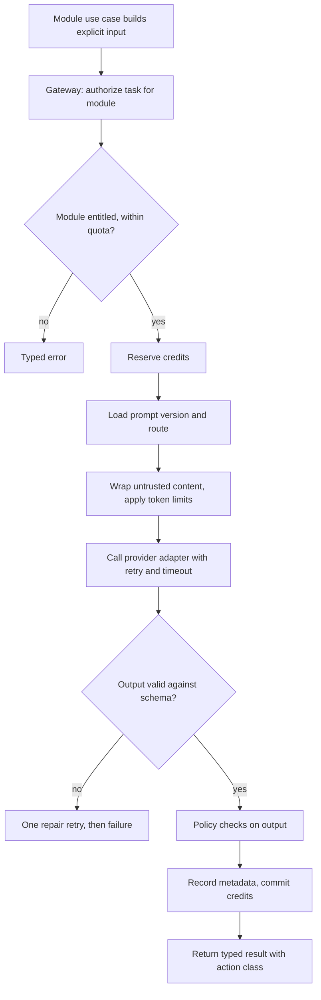

# AI Gateway

Status: planning, pending approval. No AI provider has been selected (D-05).

## Purpose

All modules use one AI service. It owns provider access, model routing, quota checks, prompt versions, output validation and logging policy. Records are in the `integration` schema: `ai_model_routes`, `prompt_templates`, `prompt_versions`, `ai_requests`.

## Request flow

## Interface

`Run(ctx, task, input, options)` returns a typed result or error.

| Field | Meaning |
|---|---|
| `task` | A registered key, such as `outreach.draft_email`; determines prompt, model route and action class |
| `input` | A typed structure defined per task, with content labelled as trusted or untrusted |
| `options` | Idempotency key, correlation ID |
| Result | Validated output, `ai_request_id`, action class, token and cost metadata |

`Embed(ctx, task, texts)` works similarly, for knowledge chunks.

The gateway has no database access to module data. It receives only what the module passes. It has no general tool system: if a task needs a capability, such as "look up availability", the module calls it and passes the result, or the task declares a small allowlist of typed actions validated by the module.

## Action classes

| Class | Meaning | Rule |
|---|---|---|
| Informational | Explains or summarizes | Labelled as AI-generated |
| Recommendation | Suggests an action | A person accepts or dismisses; never auto-applied |
| Human approval required | Produces content or action affecting outsiders | Blocked until an approval record exists, bound to a content hash |
| Prohibited without authorization | High-impact or restricted | Refused unless a separate, explicit authorization exists |

## Task catalog

| Module | Task | Class | Data provided |
|---|---|---|---|
| Lead Generation | Explain score | Informational | Score factors, public firmographics |
| Lead Generation | Suggest search criteria | Recommendation | ICP, tenant services |
| Competitor Intelligence | Extract observations from a public page | Informational, labelled inferred | Public page text, untrusted |
| Competitor Intelligence | Market report | Informational, labelled estimate | Tenant's own observations |
| Outreach | Draft email | Human approval required | Template, contact first name, title, company, approved tenant service list |
| Outreach | Classify reply | Recommendation; `unsubscribe_request` handled conservatively | Reply text, untrusted |
| Outreach | Autonomously start or expand a campaign | Prohibited | n/a |
| IT Assessment | Explain findings | Informational | Findings, no secrets |
| IT Assessment | Run or broaden checks | Prohibited: scope only comes from authorization | n/a |
| CRM | Next-step suggestion | Recommendation | Deal fields, recent activity summary |
| CRM | Change deal stage or send a message | Prohibited without user action | n/a |
| Proposals | Draft narrative content | Human approval required | Selected services and SLA, tenant-approved text |
| Proposals | Set price or discount | Prohibited: the commercial engine alone calculates | n/a |
| Visitor Intelligence | Summarize traffic | Informational | Aggregates only |
| Chatbot | Answer a question | Informational, with disclosure of AI to visitors | Retrieved chunks for that bot, conversation, untrusted |
| Chatbot | Collect qualification answers | Recommendation | Rules, conversation |
| Chatbot | Confirm a booking | Human approval not required, but the module verifies availability and only the module may confirm | Slot options supplied by the module |
| Customer Expansion | Recommend expansion | Recommendation with required rationale and evidence | Coverage, contract dates, service catalog |
| Sales Intelligence | Commentary on metrics | Informational, citing metric IDs | Aggregates; no contact data |

The gateway refuses any task not in the registered catalog. Each module's document says what it may share.

## Prompt injection defence

Web pages, replies, chat messages, uploaded documents and CRM notes are all untrusted. No single control solves prompt injection, so defences are layered around the assumption that it will sometimes succeed.

1. **Limit what a successful attack can do (most important).** Public-facing tasks get only that bot's public knowledge, so there's nothing private to reveal. No model call can send email, write data, or fetch URLs by itself.
2. **Mark boundaries.** Untrusted content goes in clearly delimited sections with instructions to treat it as data.
3. **Validate output.** Output has to match a strict schema. Links in chatbot output are checked against an allowlist, and output is rendered as escaped text.
4. **Keep decisions in code.** Booking times, prices, recipients and tenant IDs come from module code, not model output.
5. **Monitor.** Safety flags are recorded, and adversarial test sets run in CI ([testing-strategy](../implementation/testing-strategy.md)).

## Routing, limits and retries

- **Routes** map a task to provider, model, token limits and a fallback, and admins edit them. Model names aren't hard-coded.
- **Fallback** requires the alternative provider to be approved for that data class.
- **Limits:** a maximum input and output per task; context is trimmed by the module's rules, not cut blindly.
- **Retries:** transient provider errors use backoff, within a total deadline per task. Interactive tasks, like chat, fail quickly and show a fallback.
- **Idempotency:** a repeated idempotency key returns the first recorded result, where stored, or is not charged twice.

## Usage and cost

`ai_requests` records tenant, module, task, prompt version, model, token counts, estimated cost and credits. Credits are reserved first and then committed. Cost per tenant and per module appears in admin reports, and quota errors use `402 credits_exhausted`.

## Logging policy (D-07)

The default is metadata only: no prompt or completion content is stored in `ai_requests`, only a hash. Module records keep what the user needs, such as a draft or chat message, under that module's retention. Optional, short-lived content capture for debugging would need an explicit decision, a redaction step and restricted access.

Provider contract terms on training and retention must be checked before approving any provider. Tenant data must not be used for training.

## Prompt versioning

Prompt versions are immutable, and each request records which version it used. A new version runs against an evaluation set before being set active, and can be rolled back by a route change. Prompt changes are audited.

## Failure handling

| Failure | Behaviour |
|---|---|
| Provider outage | Circuit opens; fallback if approved; otherwise a typed unavailable error |
| Invalid output after repair | `validation_failed`; credits released as policy allows; UI offers retry |
| Quota exhausted | Blocked before calling the provider |
| Policy block | `policy_blocked`; security event for repeated cases |
| Deterministic features | Lead scoring, commercial calculations and forecasts' numbers don't depend on AI |
