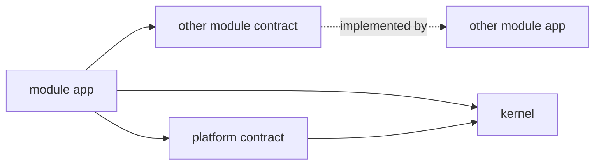
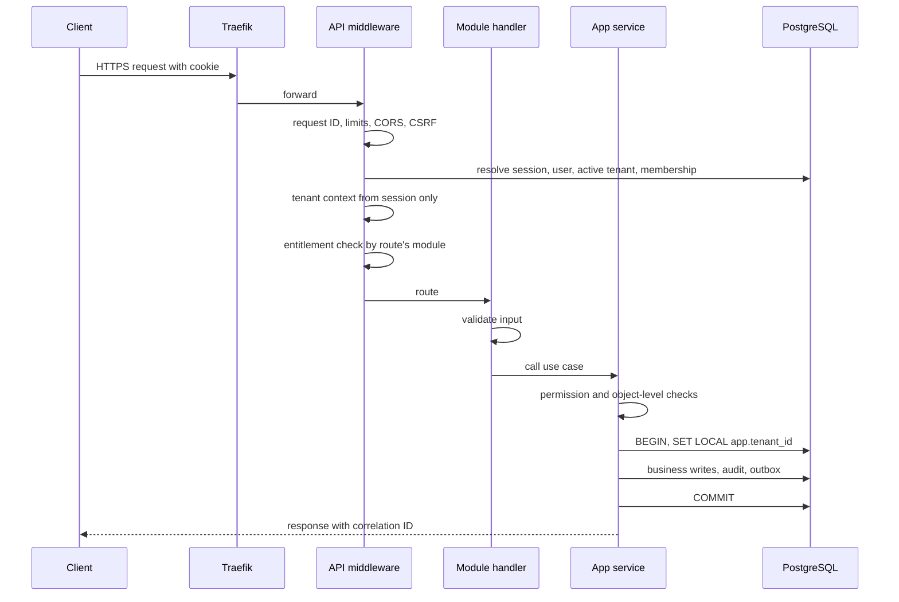

# Backend architecture

Status: planning, pending approval. The layout below is a proposal; nothing has been created.

## Repository layout

```text
backend/
  cmd/engine/              one binary: api | worker | ingest | migrate
  internal/
    modules/
      leadgeneration/  competitorintel/  outreach/  itassessment/  crm/
      proposals/  visitorintel/  chatbot/  customerexpansion/  salesintel/
    platform/              shared services with business meaning
      identity/  tenancy/  catalog/  subscription/  billing/  entitlement/
      companyidentity/  contactidentity/  aigateway/  integration/
      email/  calendar/  companydata/  notification/  audit/  usage/  files/  pdf/
    kernel/                technical building blocks with no business meaning
      db/  tenantctx/  httpserver/  authz/  outbox/  eventbus/  jobs/
      egress/  crypto/  money/  logging/  metrics/  tracing/  idempotency/  redis/
db/migrations/             central, ordered, prefixed by schema
api/openapi/               OpenAPI source
deploy/                    Docker and Traefik configuration
apps/  packages/           frontend, see frontend-architecture
docs/
```

## Shape of a module

Every business module has the same structure.

```text
modules/crm/
  contract/    the only package other code may import: service interfaces, DTOs, event payloads
  domain/      entities, state machines and rules; no database or HTTP imports
  app/         use cases; authorization, transactions, outbox and audit calls happen here
  repo/        SQL for this module's schema only
  httpapi/     handlers, request validation, response mapping
  jobs/        job handlers
  consumers/   event consumers
  module.go    wiring: routes, jobs, consumers, required entitlement
```

### Dependency rules



- `kernel` imports neither `platform` nor `modules`.
- `platform` never imports `modules`. Where a platform service needs module data it declares a port and the module registers an implementation.
- Modules import other modules' `contract` only, and the module graph must have no cycles. CI fails otherwise. Where a two-way need exists, one direction is an event.

The allowed synchronous module dependencies are in [cross-module-contracts](../modules/cross-module-contracts.md).

## Request lifecycle



Three gates apply to all tenant module routes, in this order. All three are backend checks.

1. **Authenticated:** the session is valid and the user is an active member of the tenant.
2. **Entitled:** the tenant's module entitlement is active.
3. **Authorized:** the member's role holds the required permission, and the object belongs to the tenant.

A revoked or suspended entitlement returns `403 module_not_entitled`. Read-only behaviour after lapse is D-14.

## Process roles

| Role | Work | Scaling signal | Database pool |
|---|---|---|---|
| `api` | REST, SSE, WebSocket, webhooks | CPU, p95 latency | Interactive pool |
| `ingest` | Tracker and consent events to Redis Stream | Requests per second | None for normal events |
| `worker` | Jobs, outbox dispatch, schedules, batch writes | Queue age by pool | Separate pool per worker pool |
| `migrate` | Run once before a release | n/a | Owner role, not used at runtime |

## Data access

- Parameterized SQL only. The proposed approach is hand-written SQL with generated, type-safe Go and `pgx` (D-21), which keeps RLS and partitioning explicit. No dynamic SQL from user input: sort and filter fields go through per-endpoint allowlists.
- Every tenant-scoped unit of work runs through one helper that opens a transaction and sets `app.tenant_id`. Direct pool access is limited to kernel packages and checked by lint.
- Lists use keyset pagination by default.
- Cross-tenant work, such as a schedule scanner, uses a narrowly granted system database role. It only finds work, and the actual handling then runs under each tenant's context.

## Cross-cutting behaviour

| Concern | Rule |
|---|---|
| Transactions | One module per transaction, including outbox and audit |
| External calls | Never inside a database transaction |
| Idempotency | `Idempotency-Key` for unsafe operations with side effects; stored for 24 hours (proposed) with a request hash; see [api-overview](../api/api-overview.md) |
| Concurrency | Optimistic locking through `row_version` where concurrent edits matter, such as deals |
| Time | UTC in storage and APIs; a tenant or site timezone is applied explicitly for sending windows and reports |
| Configuration | Environment plus a secret store; the service refuses to start if required values are missing |
| Errors | Domain errors map to stable codes; internal details never leave the server |
| Feature behaviour on missing modules | A cross-module call uses a contract that says whether the target is available; callers must handle "not available" |

## Migrations

- Central `db/migrations` with one ordered sequence. Each file is prefixed by its owning schema, and a review rule enforces the owner.
- Run by a dedicated role, separate from application runtime roles.
- Expand-then-contract for zero downtime: add, backfill, switch, later remove. Backfills run as throttled jobs, not inside the migration.
- Migration tests run on an empty database and on a copy of the previous release's schema.

## Library proposals

No library is decided. D-21 covers the HTTP router, SQL tooling, migration tool, job queue (build versus adopt), and OpenAPI generation. The criteria are maintenance health, licence, and whether the option works with RLS and `SET LOCAL`.
