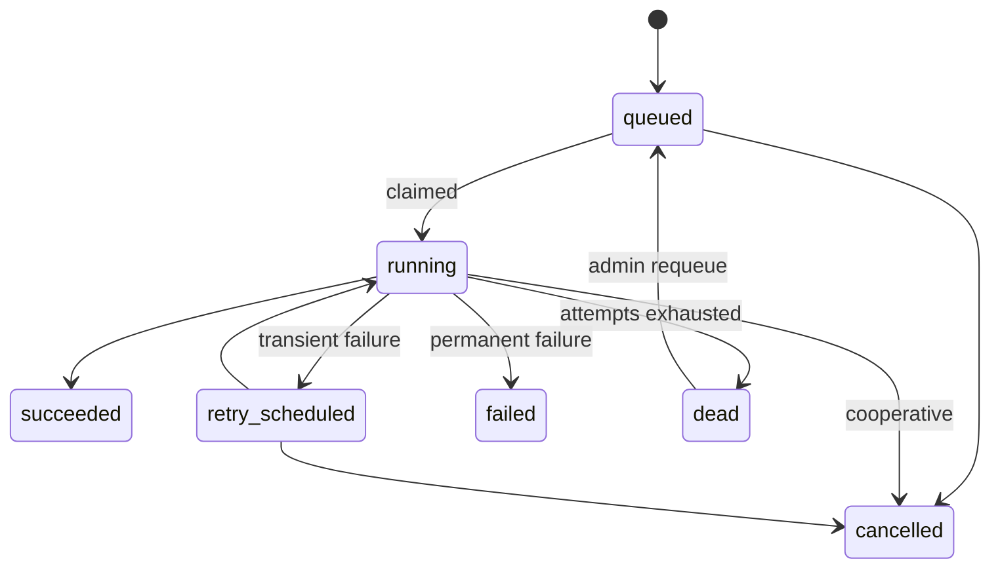

# Background jobs

Status: planning, pending approval.

## Design

PostgreSQL holds job state (`jobs.jobs`, `job_attempts`, `job_schedules`, `dead_letters`). Redis handles coordination only. Workers are Go processes in the `worker` role.

## Pools

Pools are separate so a slow provider cannot starve unrelated work. Sizes are set by configuration after load tests.

| Pool | Jobs | Why separate |
|---|---|---|
| `critical` | Outbox dispatch, entitlement effects, transactional email | Must stay fast |
| `default` | CRM reminders, renewals, imports, exports | General |
| `provider_io` | Company search, enrichment | Slow, quota-limited |
| `research_fetch` | Competitor fetches, URL knowledge | Restricted egress |
| `assessment` | Security checks | Restricted egress; strictest controls |
| `email_send` | Outreach send, reply processing | Per-sender limits, sending windows |
| `ai` | Batch AI analysis | Token and cost limits |
| `pdf` | PDF rendering | Sandbox, no network |
| `analytics` | Visitor batches, rollups, facts, forecasts | Must not affect CRM; capped connections |

## Lifecycle

## Job catalog

| Job | Pool | Idempotency key | Max attempts | Cancel | Notes |
|---|---|---|---|---|---|
| `lead.search` | provider_io | Search job ID | 5 | Yes | Progress; partial result allowed |
| `lead.enrich` | provider_io | Prospect, kind, day | 5 | Yes | Reserves lead credits |
| `lead.score` | default | Prospect, model version, input hash | 3 | No | Deterministic |
| `lead.import` and `lead.export` | default | Job ID | 3 | Yes | Row-level report |
| `competitor.research` | research_fetch | Run ID | 3 | Yes | Respects robots |
| `competitor.analyze` | ai | Run ID | 3 | Yes | AI extraction |
| `competitor.report` | ai | Report ID | 3 | Yes | |
| `outreach.schedule_tick` | email_send | Minute bucket | n/a | No | Finds due enrollments |
| `outreach.send` | email_send | Message idempotency key | 5 | Yes | Re-checks suppression, approval and entitlement just before sending |
| `outreach.process_reply` | email_send | Provider message ID | 5 | No | Stops the sequence first |
| `outreach.domain_check` | default | Domain, day | 3 | No | |
| `assessment.run` | assessment | Assessment ID | 2 | Yes | Check-level retries; re-checks authorization |
| `*.pdf` | pdf | Document version | 3 | No | |
| `proposal.expire` | default | Version ID | 3 | No | |
| `visitor.flush` | analytics | Stream batch ID | Many | No | Batched writes |
| `visitor.rollup` | analytics | Site, day | 3 | No | Rebuildable |
| `visitor.partition_retention` | analytics | Month | 3 | No | Drops expired partitions |
| `chatbot.ingest_source` | ai | Source version | 3 | Yes | Scan, chunk, embed |
| `chatbot.sync_crm` | default | Conversation ID | 5 | No | Registry command |
| `expansion.renewal_scan` | default | Tenant, day | 3 | No | |
| `expansion.analyze` | ai | Customer, day | 3 | Yes | |
| `analytics.metric_rollup` | analytics | Tenant, metric, period | 3 | No | |
| `analytics.forecast` | analytics | Tenant, kind, as-of date | 3 | Yes | |
| `files.scan` and `files.purge` | default | Object ID | 5 | No | |
| `billing.reconcile` | default | Day | 3 | No | |
| `privacy.erase_contact` and `tenant.purge` | default | Request ID | Many | No | Resumable per module |

## Mechanics

**Creation.** A job row is inserted in the same transaction as the business change, so neither can exist without the other. `(tenant_id, kind, idempotency_key)` is unique, so a duplicate request returns the existing job.

**Claiming.** Workers use `FOR UPDATE SKIP LOCKED`, ordered by priority and `run_at`, and set `lock_expires_at`. Long jobs extend it with a heartbeat. A reaper returns jobs with an expired lock. A worker's crash therefore leads to a retry, so all handlers must be idempotent.

**Wake-ups.** Redis or `LISTEN/NOTIFY` wakes workers quickly. Polling is the fallback.

**Retries.** Exponential backoff with full jitter, with per-kind maximums. Errors are classified as:
- `retryable`: try again.
- `rate_limited`: reschedule at `Retry-After` without using an attempt.
- `permanent`: fail at once.
- Provider circuit open: reschedule without using an attempt.

**Dead letters.** Exhausted jobs go to `jobs.dead_letters`, visible in admin. Requeue or discard needs a reason, is audited, and alerts on growth.

**Cancellation.** `cancel_requested_at` is set, and handlers check it between units of work. Cancelling releases credits and shows partial results. A provider call in flight may still complete, so handlers re-check before starting a side effect.

**Progress.** Handlers update `progress` at most every few seconds, and SSE messages tell the client to refetch.

**Tenant scoping.** Handlers receive tenant context from the job row, then run with RLS. Payloads hold IDs, not data. The payload includes `payload_version`, so old jobs still work after a release.

**Fair sharing.** Redis tracks in-flight jobs per tenant and pool. A tenant over its limit has a job returned with a short delay, so one tenant's 100,000-row import can't block the queue. If Redis is down, per-worker limits apply, at lower throughput.

**Rate limits.** Provider token buckets by provider and connection. Outreach also applies per-sender daily limits and reputation states. The database holds the authoritative counts.

**Schedules.** `job_schedules` holds cron-like entries. One scheduler at a time, by advisory lock, creates runs. Idempotency keys make missed or doubled ticks safe. Per-tenant recurring work is jittered to avoid spikes.

**Deployments.** Workers stop claiming on SIGTERM, finish within a deadline, and any remaining jobs get reclaimed.

## Monitoring

Per pool: queue depth, oldest-job age, run time, success and failure rate, retries, dead letters, and worker heartbeat. Alerts are per-pool, because a stuck `email_send` pool matters differently from a slow rollup.

## Tests

Crash mid-job; duplicate delivery; retry classification; cancellation with credit release; fair sharing with one heavy tenant; Redis outage; a job that outlives a revocation; and payload version compatibility.
