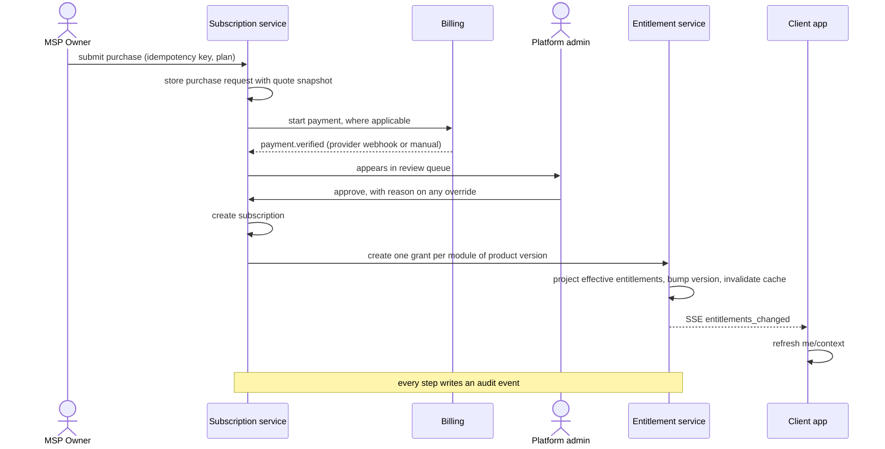
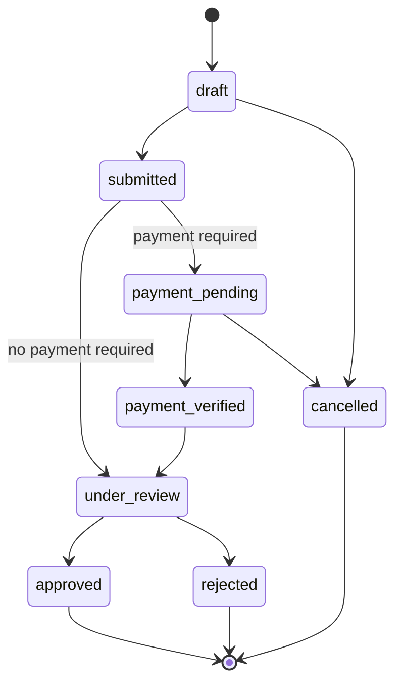
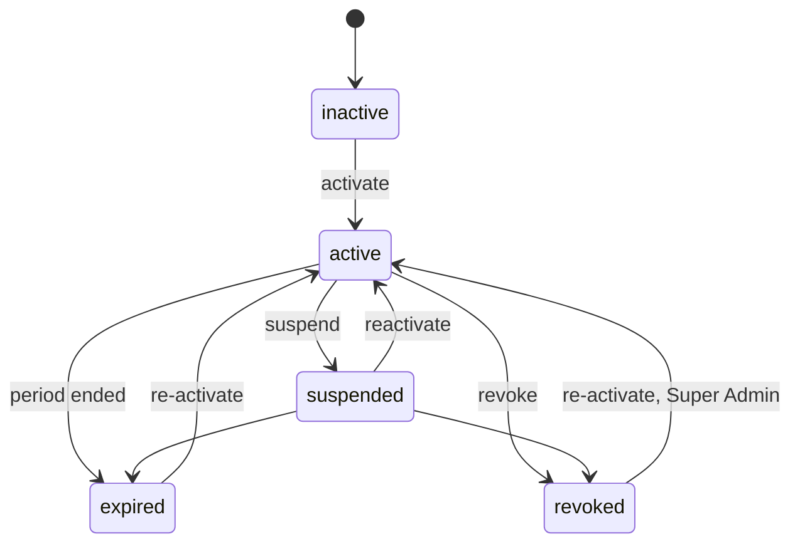

# Commercial model and module activation

Status: planning, pending approval. Pricing is not set here, and all prices are admin-configured data.

## Concepts

| Concept | Meaning | Changes by |
|---|---|---|
| Module | A technical capability; exactly ten | Code release |
| Product | Something sold: module, bundle, suite, add-on | Admin |
| Product version | Immutable contents of a product at a point in time | Admin publishes |
| Plan | Period, trial, limits and credits for a product version | Admin |
| Price | Amount by currency, with a validity window | Admin |
| Purchase request | A tenant's request and its quote snapshot | Tenant, then admin |
| Subscription | The commercial agreement | System and admin |
| Entitlement grant | One source of access to one module | Admin or system |
| Effective entitlement | Whether the tenant can use the module now | Calculated from grants |

## Seed bundles

These are seed data from the brief, editable by admins.

| Bundle | Modules |
|---|---|
| Prospecting | Lead Generation, Competitor Intelligence |
| Marketing | Outreach, Visitor Intelligence, Chatbot |
| Sales | CRM, IT Assessment, Proposals |
| Growth | Customer Expansion, Sales Intelligence |
| Complete | All ten |

**Issue for D-02.** Growth lacks CRM, though it is the owner of customer and deal data. With the recommended registry contract, Growth tenants would get customer records through Customer Expansion's UI, and Sales Intelligence would show only what is available. Alternatively, Growth could include CRM or require it.

## Activation flow

### Purchase request states

### Entitlement states

## Effective entitlement calculation

A module's effective status comes from all that tenant's grants for it:

1. Any `active` grant within its dates: **active**.
2. Otherwise, any `suspended` grant: **suspended**.
3. Otherwise, most recent `expired` or `revoked`: that status.
4. No grants: **inactive**.

**Example.** A tenant has CRM through the Sales bundle and also a standalone CRM subscription. Cancelling the bundle leaves CRM active.

**Tenant-wide suspension** is separate. It is held on the tenant and blocks everything, whatever the entitlements say.

## Consequences of status changes

| Status | User access | Running work | Data |
|---|---|---|---|
| active | Full | Runs | Retained |
| suspended | Status page | Paused; outreach sequences stop sending; widgets return inactive | Retained |
| expired | Read-only for a grace period, then status page (D-14) | Cancelled or paused | Retained until retention ends |
| revoked | Status page | Cancelled; active sends stop immediately | Retained until retention ends; export path via Owner |

A check at job start and before each external side effect means a job created while entitled won't send email after revocation.

## Trials and promotions

Trials are plans with `trial_days`. Whether a trial also needs admin activation is not specified; the plan assumes it does, for consistency with "administrator controlled". Promotions are recorded on the quote snapshot, and redemption limits are enforced transactionally.

## Usage limits and credits

- AI credits and lead credits are meters, with values set per plan and adjustable per tenant.
- **Reservation pattern:** reserve, call the provider, commit actual use, release the rest.
- Reaching a hard limit stops new consuming work with `402 credits_exhausted`. Non-consuming features continue.
- Credit prices and conversion from provider cost are commercial decisions, not set here.

## Admin capabilities

| Capability | Role |
|---|---|
| Products, bundles, plans, prices, promotions | Billing Admin, Super Admin |
| Review purchases, activate, suspend, expire | Billing Admin, Super Admin |
| Revoke, or reactivate after revoke | Super Admin |
| Grant credits or set usage limits | Billing Admin, Super Admin |
| Verify a manual payment | Billing Admin |
| View subscriptions | Platform Support, Platform Analyst (read-only) |

Two-person approval for large credits or revocations is a possible later control.

## Open decisions

- **D-01:** when to capture payment relative to admin review. Recommended: capture at submit, keep review quick with a stated target, and refund automatically on rejection, if D-04's provider supports it.
- **D-04:** payment provider versus merchant of record for worldwide tax.
- **D-18:** whether unpaid subscriptions expire automatically under an admin-set policy (recommended) or only by manual admin action.
