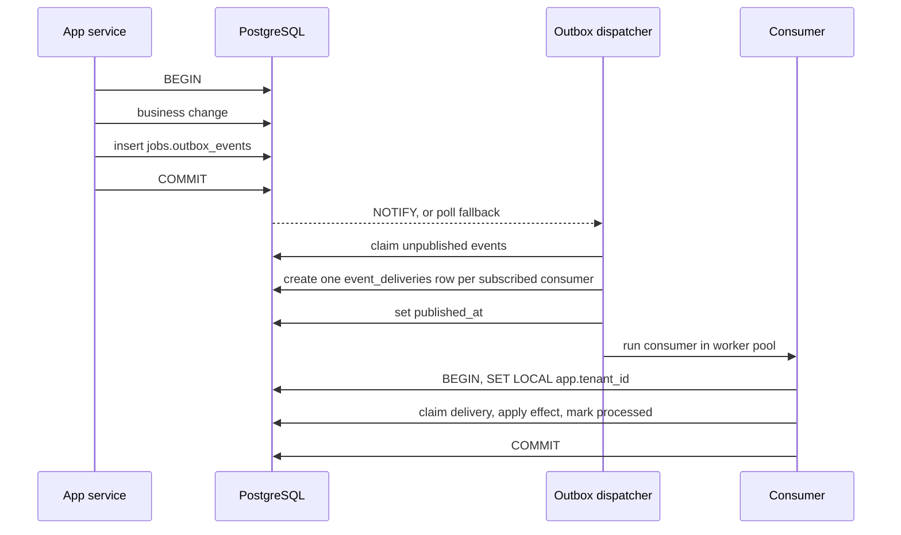

# Event architecture

Status: planning, pending approval. The catalog of events is in [event-contracts](../api/event-contracts.md).

## When to use what

| Mechanism | Use when | Example |
|---|---|---|
| Synchronous contract call | The caller needs an answer now, and can show an error if it fails | Check suppression before send |
| Event | Other modules should react later; the publisher doesn't care who | `crm.deal.won` |
| Job | Slow, retryable work inside one module | Enrich a prospect |
| Command by job | One module needs another to act reliably, with idempotency | Lead Generation asks CRM to create a company from a prospect |

## Envelope

All events use this envelope.

| Field | Type | Notes |
|---|---|---|
| `event_id` | UUIDv7 | Consumers deduplicate on this |
| `event_type` | string | `<module>.<aggregate>.<past_tense>`, such as `crm.deal.won` |
| `schema_version` | int | Increases only on a breaking payload change |
| `tenant_id` | UUID or null | Null only for platform-level events |
| `source_module` | string | Publisher |
| `aggregate_type`, `aggregate_id` | string, UUID | Used for ordering |
| `occurred_at` | timestamp | Business time |
| `correlation_id` | UUID | Follows the whole workflow |
| `causation_id` | UUID or null | Event or request that directly caused this |
| `payload` | object | Versioned, minimal, documented |

### Payload rules

- **IDs and facts, not copies of records.** A consumer needing more calls the owner's contract, under the event's tenant.
- **Minimal personal data.** Payloads carry a `contact_id`, not an email or name. Events live for a while in the outbox and in logs, and carrying IDs means an erasure need not chase event history.
- **No free text from users or prospects.** That avoids PII and untrusted content moving through events. Any exception must be documented in the contract.
- **Money** uses minor units and currency.

## Publishing

Claiming the delivery row and writing the business effect share one transaction, so if a consumer's database work is in the same module, duplicates have no effect. Where a consumer also calls an external system, it must pass an idempotency key derived from `event_id`.

## Ordering

Dispatch follows outbox `sequence`, which is only approximately global. The one firm guarantee is per aggregate: the dispatcher will not start the next delivery of an aggregate to the same consumer while an earlier one is unfinished. Consumers must still tolerate replays, and they use a timestamp or version comparison when applying state, because retries can follow other work.

## Consumers

Each consumer is registered in code, with a name, its event types, handler, retry policy, and whether it respects entitlement.

| Consumer's responsibility | Rule |
|---|---|
| Idempotent | Second delivery changes nothing |
| Tenant-safe | Runs under the event's tenant context, with RLS applied |
| Bounded | Long work is delegated to a job |
| Tolerant | Ignores unknown fields; accepts all supported schema versions |
| Entitlement aware | Declares `passive` (always runs, ADR-014) or `active` (skips if the module isn't entitled) |

## Failure handling

Retries use exponential backoff with jitter. After the maximum attempts, the delivery is marked `dead` and copied to `jobs.dead_letters`, and an alert is raised. Platform admins can requeue or discard with an audit record. A poison event cannot block other aggregates, or other consumers of the same event.

## Versioning

- Adding optional fields needs no version change.
- A breaking change means a new `schema_version`. The publisher emits the new version only after all consumers accept it, and support for old versions lasts until all retained events are gone.
- Contract tests pin every payload's schema, with the publisher and each consumer tested against the same fixtures.

## Retention and replay

Outbox rows are dropped by partition 30 days after delivery (proposed). Delivered events are a transport, not an event store, so they can't rebuild everything. Sales Intelligence facts, which must last longer, have their own tables. Replay within retention is an admin operation scoped by consumer, event type and time range, and is safe because consumers are idempotent.

## Monitoring

Alerts on: oldest unpublished event age, per-consumer lag, dead-letter count, dispatcher heartbeat, and failed partition creation.
