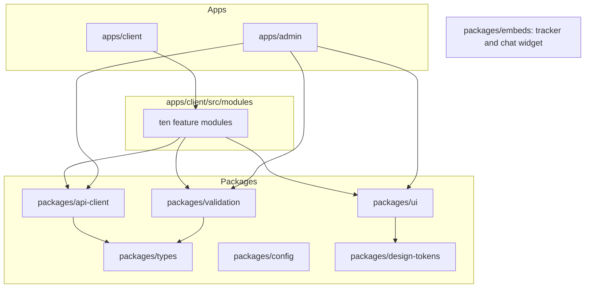

# Frontend architecture

Status: planning, pending approval. Details of folders and routes are in [application-structure](../frontend/application-structure.md), and each screen is in [screen-inventory](../frontend/screen-inventory.md).

## Decisions

- **Client app:** one React, Vite and TypeScript application with shadcn/ui, Tailwind CSS and Lucide React. One shell and ten feature modules, one build.
- **Admin app:** a separate application with the same stack, on its own hostname, with its own session. It shares UI packages but no feature code.
- **No runtime microfrontends.** Modules are separated at build time by folders and lint rules, and at runtime by lazy-loaded routes.

## Why admin is fully separate

Separate hostnames give a separate cookie scope and CSP, so an XSS defect in client code cannot act with an admin session. Admin code also never ships to MSP users, so internal tooling and endpoints are not revealed to them.

## Layers

Rules enforced by lint:

1. A feature module may not import from another feature module. Shared needs move to a package, or the shell composes them.
2. Each module exposes one manifest, with its module key, routes, navigation entries, required permissions and any dashboard widgets. The shell reads manifests and knows nothing else about the module.
3. Only `packages/api-client` calls the network. Its types are generated from OpenAPI, so a backend contract change fails the frontend build.
4. `packages/embeds` imports no React or shell code, and has a size budget, because it loads on customers' websites.

## Entitlements in the frontend

`GET /api/v1/me/context` returns the user, active tenant, permissions and module statuses. The shell uses it to choose navigation and to show either the module or an upgrade or status page.

This is only presentation. The backend enforces every entitlement and permission. If a request returns `403 module_not_entitled`, the shell refreshes context and shows the module's status page. After an admin activates a module, a `tenant.entitlements_changed` SSE message prompts a refresh, and the same context is refetched on focus as a fallback.

## State

| Kind | Approach |
|---|---|
| Server data | A query cache per module, using query keys prefixed by tenant so that switching tenants drops all cached data |
| Form state | A form library, with validation schemas from `packages/validation` |
| URL state | Filters, sorting and pagination live in the URL, so views can be linked |
| Session state | `me/context` query, not browser storage |
| Module UI state | Small stores local to that module, never global |

Library choices are in D-21. No tokens or tenant data are placed in local storage.

## Real-time

One SSE connection per tab carries a small typed stream: job progress, notifications, entitlement changes. Messages only signal; the UI refetches through REST, so a dropped message costs freshness, not data. Live human-handoff chat is the only WebSocket use.

## Quality targets

- WCAG 2.2 AA as the design target.
- Responsive to mobile for review tasks. Complex builders, such as the sequence builder and proposal editor, are desktop-first with a read-only mobile view.
- All text is externalized from the start. The launch locale list is not decided, but a worldwide market makes this hard to add later. Dates, numbers and money are formatted through locale-aware helpers.
- Route-level code splitting with per-route bundle budgets in CI.
- Strict CSP without inline scripts; AI-generated and user-authored content is rendered as escaped text or through one allowlist sanitizer.

## Public surfaces

Public pages and embeddable widgets do not fit the "two applications" statement, so D-15 asks for confirmation. The recommendation:

- **Tracker and chat widget:** `packages/embeds`, built separately and served from a static path. These can't be part of the app build.
- **Public pages (assessment landing page, proposal view, unsubscribe, invitation acceptance):** a route group in the client build, loading only a public chunk, with no authenticated shell code. Moving them to a separate host later stays possible, since they only call `/api/v1/public/*`.
