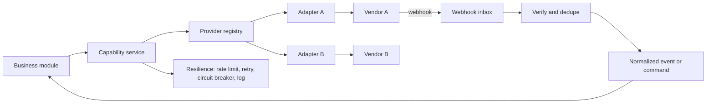

# Integration architecture

Status: planning, pending approval. No external provider has been selected, and none is assumed available at a particular price (D-05).

## Principle

Business modules know capabilities, not vendors. `outreach` asks to "send this email through this connection"; it never imports an email vendor's SDK. Vendor code lives only in adapters.

## Capabilities

| Capability | Service | Operations | Credential owner | Candidate consumers |
|---|---|---|---|---|
| AI | AI Gateway | Complete, embed | Platform (tenant keys are D-05) | All AI features |
| Company data | Company Data Provider Management | Search, enrich company, enrich contact | Platform | Lead Generation, Competitor Intelligence |
| Business identification | Company Data Provider Management | Resolve IP to business | Platform | Visitor Intelligence |
| Email sending | Email Provider Management | Send, check status, parse events, verify domain | Tenant or platform | Outreach, Notification |
| Mailbox reading | Email Provider Management | Detect replies | Tenant OAuth | Outreach |
| Calendar | Calendar Provider Management | Read availability, create or cancel event | Tenant OAuth | Chatbot, CRM, IT Assessment |
| Payment | Billing | Create checkout, read payment state, parse events | Platform | Billing |
| E-signature | Proposal signature port | Create envelope, read status, parse events | Tenant or platform | Proposals |
| FX rates | Reference data import | Fetch daily rates | Platform | Sales Intelligence |

## Adapter contract

Each adapter declares capability, identifier, feature support, rate limit hints, error mapping to a common set (`retryable`, `permanent`, `rate_limited`, `auth_failed`, `not_found`), and data-handling metadata (region, retention, licence class of returned data). Callers must handle a missing capability: for example, not every email provider offers reply webhooks, so reply detection may need mailbox polling.

## Credentials

- Encrypted with envelope encryption. A key-encryption key from a managed secret store wraps data keys; ciphertext and `key_id` are stored together.
- Decrypted only inside `integration`, and only in the worker or API call that needs them. Never logged, returned by an API, or passed to AI.
- OAuth flows use PKCE and a signed, tenant-bound `state`. Refresh happens in a job. On failure the connection goes to `needs_reauth`, and the tenant is notified.
- Rotation is supported by `key_id` and re-wrapping without downtime.

## Inbound webhooks

1. Traefik routes `/api/v1/webhooks/{provider}/{pathToken}`.
2. Body-size limits are checked before anything else.
3. The endpoint is looked up by token.
4. Signature and timestamp are verified using the provider's scheme. A failure returns 401, stores a hash only, and writes a security event.
5. The delivery is inserted into `integration.webhook_deliveries`, deduplicated by provider event ID. A repeated delivery returns 200.
6. A 2xx is returned quickly, and processing runs in a job, so a slow module cannot make the provider retry.
7. The payload is normalized and passed to the owning module's command or event.

Tenant comes from the endpoint record, or from a provider object that the platform has already mapped to a tenant. Never from an unverified payload field.

## Resilience

| Mechanism | Rule |
|---|---|
| Timeouts | Each operation has its own timeout; no unbounded calls |
| Retry | Only `retryable` and `rate_limited`, with exponential backoff and jitter; honour `Retry-After` |
| Rate limits | Redis token buckets per provider and per connection |
| Circuit breaker | Per provider; opening it moves that provider to `degraded`, and jobs reschedule instead of burning attempts |
| Fallback | Allowed only where configured and legally suitable; a fallback must not send personal data to an unapproved provider |
| Cost control | Credits are reserved before a costly call, and committed or released afterward |
| Observability | `integration.provider_call_logs` holds metadata only, plus metrics per provider |

## Failure handling by capability

| Failure | Result |
|---|---|
| Company data down | Search job marked `partial` or retried; credits released |
| AI down | AI features show unavailable; rule-based results, such as lead scores, still work |
| Email provider down | Messages stay queued; send window is respected on recovery |
| Calendar down | Chatbot does not confirm; offers a callback request or human handoff |
| Payment webhook delayed | Purchase stays `payment_pending`; a reconciliation job polls; Billing Admin can see it |
| E-sign down | Proposal remains issued; signature request retried; the customer view still works |

## Legal limits on data sources

The design only allows sources with a licence record. Collecting data from sources that prohibit it is out of scope: each company-data adapter records a licence class, and exports honour it. Competitor research respects `robots.txt` and rate limits, and each source has an access status. Whether specific sources may be used is for review with the chosen provider contracts and counsel.
