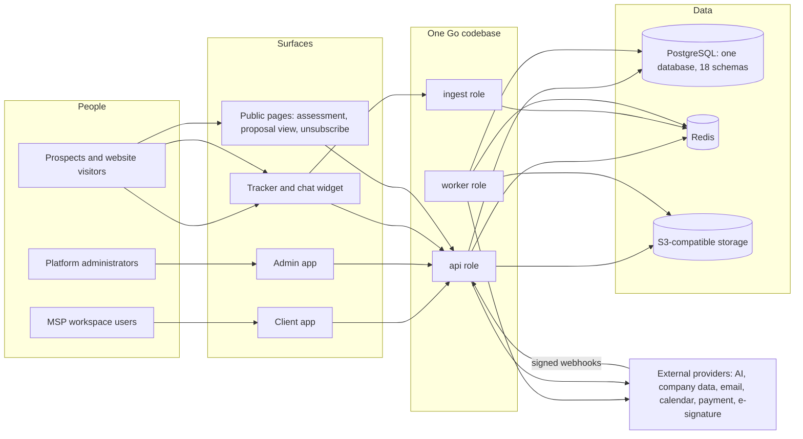
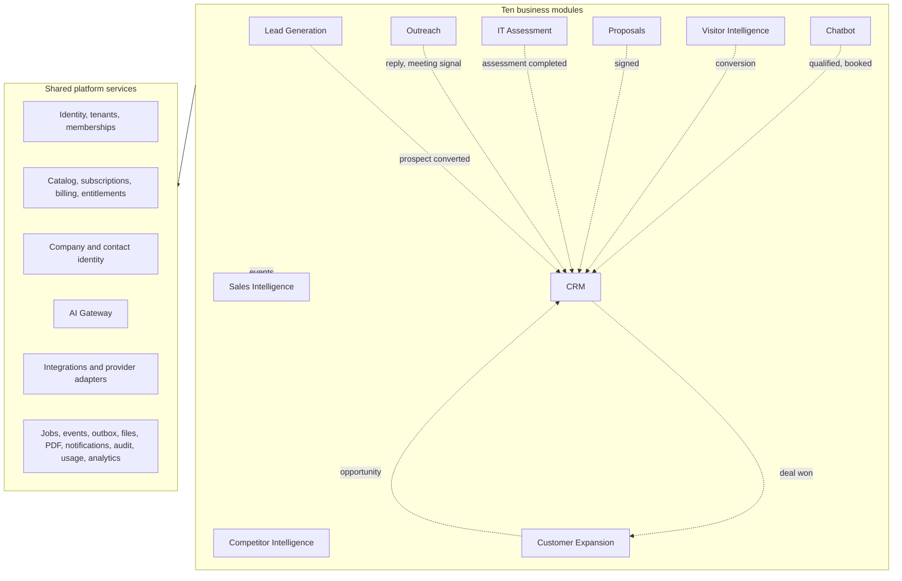

# System overview

Status: planning, pending approval.

## What is being built

MSP Growth Engine is one multi-tenant SaaS product with ten business modules. MSPs worldwide use it to find prospects, research competitors, run compliant outreach, offer security assessments, manage a pipeline, issue proposals, convert website visitors, expand existing customers, and forecast recurring revenue.

MSPs can buy one module, a bundle, or the complete suite. A platform administrator activates what was purchased, and access then applies to the whole workspace.

## Starting point

The project directory was empty when this was written: no files, no git repository, nothing to migrate or preserve. The machine has Go 1.27.2, Node 24.19 and Docker 29.9. All layout proposals are therefore new.

## System context

Traefik terminates TLS in front of every surface and routes `app`, `admin`, `api` and `ingest` hostnames.

## Module map

Solid arrows are synchronous dependencies through documented service interfaces. Dotted arrows are events. Module-to-module synchronous calls are listed in [cross-module-contracts](../modules/cross-module-contracts.md).

## Key properties

| Property | How it is achieved | Reference |
|---|---|---|
| Module independence | Each module owns one schema, exposes a contract package, and is blocked by lint rules from importing another module's internals | [backend-architecture](backend-architecture.md) |
| Modules sold separately still work | Each module runs without the others. Cross-module calls degrade or use the CRM registry contract | [module-overview](../modules/module-overview.md), D-02 |
| Tenant isolation | Server-side tenant context, composite foreign keys, forced RLS, isolation tests | [multi-tenancy](multi-tenancy.md) |
| Sales and access stay separate | Products grant entitlement grants; request checks read only effective entitlements | [commercial-and-activation](commercial-and-activation.md) |
| Reliable side effects | Transactional outbox, per-consumer delivery tracking, idempotent consumers | [event-architecture](event-architecture.md) |
| Safe AI | One gateway; each module chooses its AI input; four action classes | [ai-gateway](ai-gateway.md) |
| Analytics cannot harm CRM | Separate ingest role, connection pools and partitions | [observability-and-reliability](observability-and-reliability.md) |

## Issues found in the brief

These come from reading the requirements closely. None were resolved silently. Each is in [open-decisions](../implementation/open-decisions.md).

1. **The Growth bundle has no CRM.** The brief makes CRM the owner of customer identity and deals, yet Growth is Customer Expansion plus Sales Intelligence. A Growth-only tenant would have no customers and no deals. Standalone Proposals, Chatbot and IT Assessment purchases have a smaller version of the same gap (D-02).
2. **Paying before admin review means money can be held for a rejected request.** The workflow verifies payment, then a human reviews. The refund path and review wait need a policy (D-01).
3. **Auth in Phase 1 needs email, but Notifications arrive in Phase 2.** Email verification and password reset cannot wait. The roadmap adds a minimal transactional mail adapter to Phase 1.
4. **The brief asks for two frontend applications, but some surfaces fit neither.** The tracker and chat widget must be embedded on third-party sites. The assessment landing pages, proposal view page and unsubscribe page are public and unauthenticated (D-15).
5. **A global contact record conflicts with the likely privacy roles.** If the platform merges people across tenants, it risks acting as a controller of that data and may breach provider licences. The plan keeps contacts tenant-scoped (D-06).
6. **Cold email rules differ sharply by country.** CASL and several EU national rules can require consent even for B2B email. A global product needs per-recipient policy gates, which need legal input (D-10).
7. **"Free assessment" and "explicit authorization" pull in opposite directions.** Requiring proof of domain control before any check would hurt conversion; accepting anyone's claim on active checks is unsafe. The plan proposes two tiers (D-12).
8. **Module 9 lists "existing customer management" but CRM owns customer identity.** The plan has Customer Expansion hold only an overlay on CRM's record. It also needs one place for recurring revenue facts (D-03).
9. **A 99.9% availability objective cannot be met on one host.** The infrastructure stack names Docker and Traefik but no topology (D-23).
10. **The brief defines no schema for the AI Gateway or the outbox.** Rather than add schemas, AI records go in `integration` and the outbox goes in `jobs`.
