# Product, bundle, subscription and entitlement ERD

Status: **planning, pending approval.** Generated from the same specification as the [data dictionary](data-dictionary.md), which remains the fuller reference. Tenant foreign keys are omitted from the relationship lines to keep diagrams readable: assume every table with `tenant_id` belongs to `identity.tenants`. Attribute comments mark foreign keys and logical refs that point outside the diagram.

Products and entitlements are separate concepts. A published product version lists modules; an approved subscription creates one entitlement grant per module; grants project into `tenant_module_entitlements`, the row checked at request time. A tenant holding a module through both a bundle and a standalone purchase therefore keeps access when either one ends.

```mermaid
erDiagram
    platform__modules ||--o{ platform__module_dependencies : "module_id"
    platform__modules ||--o{ platform__module_dependencies : "depends_on_module_id"
    platform__products ||--o{ platform__product_versions : "product_id"
    platform__product_versions ||--o{ platform__product_version_modules : "product_version_id"
    platform__modules ||--o{ platform__product_version_modules : "module_id"
    platform__product_versions ||--o{ platform__plans : "product_version_id"
    platform__plans ||--o{ platform__prices : "plan_id"
    platform__promotions ||--o{ platform__promotion_redemptions : "promotion_id"
    platform__purchase_requests ||--o{ platform__promotion_redemptions : "purchase_request_id"
    platform__plans ||--o{ platform__purchase_requests : "plan_id"
    platform__promotions |o--o{ platform__purchase_requests : "promotion_id"
    platform__plans ||--o{ platform__subscriptions : "plan_id"
    platform__purchase_requests |o--o{ platform__subscriptions : "purchase_request_id"
    platform__modules ||--o{ platform__entitlement_grants : "module_id"
    platform__subscriptions |o--o{ platform__entitlement_grants : "subscription_id"
    platform__modules ||--o{ platform__tenant_module_entitlements : "module_id"
    platform__modules ||--o{ platform__entitlement_status_history : "module_id"
    platform__entitlement_grants |o--o{ platform__entitlement_status_history : "grant_id"
    platform__subscriptions |o--o{ platform__invoices : "subscription_id"
    platform__invoices ||--o{ platform__invoice_lines : "invoice_id"
    platform__invoices |o--o{ platform__payments : "invoice_id"
    platform__purchase_requests |o--o{ platform__payments : "purchase_request_id"
    platform__usage_meters ||--o{ platform__credit_accounts : "meter_id"
    platform__credit_accounts ||--o{ platform__credit_ledger : "account_id"
    platform__usage_meters ||--o{ platform__tenant_usage_limits : "meter_id"
    platform__usage_meters ||--o{ platform__usage_rollups : "meter_id"
    platform__settings {
        text key PK
        jsonb value
        uuid updated_by "logical ref identity.platform_admins"
        timestamptz updated_at
    }
    platform__modules {
        uuid id PK
        timestamptz created_at
        timestamptz updated_at
        text key
        text name
        text description
        text status
        jsonb default_limits
        int sort_order
    }
    platform__module_dependencies {
        uuid module_id PK,FK
        uuid depends_on_module_id PK,FK
        text kind
    }
    platform__products {
        uuid id PK
        timestamptz created_at
        timestamptz updated_at
        text key
        text kind
        text name
        text description
        text status
    }
    platform__product_versions {
        uuid id PK
        timestamptz created_at
        timestamptz updated_at
        uuid product_id FK
        int version
        text status
        timestamptz effective_from
        timestamptz effective_to
    }
    platform__product_version_modules {
        uuid product_version_id PK,FK
        uuid module_id PK,FK
    }
    platform__plans {
        uuid id PK
        timestamptz created_at
        timestamptz updated_at
        uuid product_version_id FK
        text key
        text name
        text billing_period
        int trial_days
        jsonb usage_limits
        jsonb included_credits
        text status
    }
    platform__prices {
        uuid id PK
        timestamptz created_at
        timestamptz updated_at
        uuid plan_id FK
        char currency
        bigint amount_minor
        timestamptz valid_from
        timestamptz valid_to
    }
    platform__promotions {
        uuid id PK
        timestamptz created_at
        timestamptz updated_at
        citext code
        text kind
        numeric percent_off
        bigint amount_off_minor
        char currency
        int max_redemptions
        timestamptz valid_from
        timestamptz valid_to
        text status
    }
    platform__promotion_redemptions {
        uuid id PK
        uuid tenant_id FK "FK identity.tenants"
        timestamptz created_at
        uuid promotion_id FK
        uuid purchase_request_id FK
    }
    platform__purchase_requests {
        uuid id PK
        uuid tenant_id FK "FK identity.tenants"
        timestamptz created_at
        timestamptz updated_at
        uuid plan_id FK
        uuid promotion_id FK
        int quantity
        jsonb quote_snapshot
        text status
        text idempotency_key
        uuid requested_by "logical ref identity.users"
        uuid reviewed_by "logical ref identity.platform_admins"
        timestamptz reviewed_at
        text rejection_reason
    }
    platform__subscriptions {
        uuid id PK
        uuid tenant_id FK "FK identity.tenants"
        timestamptz created_at
        timestamptz updated_at
        uuid plan_id FK
        uuid purchase_request_id FK
        text status
        jsonb price_snapshot
        char currency
        timestamptz current_period_start
        timestamptz current_period_end
        timestamptz trial_ends_at
        timestamptz cancel_at
        text provider_subscription_ref
    }
    platform__entitlement_grants {
        uuid id PK
        uuid tenant_id FK "FK identity.tenants"
        timestamptz created_at
        timestamptz updated_at
        uuid module_id FK
        uuid subscription_id FK
        text source
        text status
        timestamptz starts_at
        timestamptz ends_at
        uuid activated_by "logical ref identity.platform_admins"
        text status_reason
    }
    platform__tenant_module_entitlements {
        uuid id PK
        uuid tenant_id FK "FK identity.tenants"
        timestamptz created_at
        timestamptz updated_at
        uuid module_id FK
        text status
        timestamptz effective_from
        timestamptz effective_until
        bigint entitlement_version
    }
    platform__entitlement_status_history {
        uuid id PK
        uuid tenant_id FK "FK identity.tenants"
        timestamptz created_at
        uuid module_id FK
        uuid grant_id FK
        text from_status
        text to_status
        text actor_type
        uuid actor_id
        text reason
    }
    platform__invoices {
        uuid id PK
        uuid tenant_id FK "FK identity.tenants"
        timestamptz created_at
        timestamptz updated_at
        uuid subscription_id FK
        text number
        text status
        char currency
        bigint subtotal_minor
        bigint tax_minor
        bigint total_minor
        timestamptz issued_at
        timestamptz due_at
        timestamptz paid_at
        text provider_invoice_ref
        uuid pdf_file_id "logical ref files.objects"
    }
    platform__invoice_lines {
        uuid id PK
        uuid tenant_id FK "FK identity.tenants"
        timestamptz created_at
        timestamptz updated_at
        uuid invoice_id FK
        text description
        int quantity
        bigint unit_amount_minor
        bigint amount_minor
        timestamptz period_start
        timestamptz period_end
    }
    platform__payments {
        uuid id PK
        uuid tenant_id FK "FK identity.tenants"
        timestamptz created_at
        timestamptz updated_at
        uuid invoice_id FK
        uuid purchase_request_id FK
        text provider
        text provider_payment_ref
        text method
        text status
        bigint amount_minor
        char currency
        uuid verified_by "logical ref identity.platform_admins"
        timestamptz verified_at
    }
    platform__usage_meters {
        uuid id PK
        timestamptz created_at
        timestamptz updated_at
        text key
        text name
        text unit
        text status
    }
    platform__credit_accounts {
        uuid id PK
        uuid tenant_id FK "FK identity.tenants"
        timestamptz created_at
        timestamptz updated_at
        uuid meter_id FK
        bigint balance
        bigint reserved
    }
    platform__credit_ledger {
        uuid id PK
        uuid tenant_id FK "FK identity.tenants"
        timestamptz created_at
        uuid account_id FK
        text entry_type
        bigint amount
        text source_module
        text reference_type
        uuid reference_id
        text idempotency_key
        timestamptz expires_at
        text actor_type
        uuid actor_id
    }
    platform__tenant_usage_limits {
        uuid id PK
        uuid tenant_id FK "FK identity.tenants"
        timestamptz created_at
        timestamptz updated_at
        uuid meter_id FK
        text period
        bigint limit_value
        boolean hard_stop
    }
    platform__usage_rollups {
        uuid id PK
        uuid tenant_id FK "FK identity.tenants"
        timestamptz created_at
        timestamptz updated_at
        uuid meter_id FK
        text module_key
        date period_start
        bigint quantity
        bigint cost_estimate_minor
    }
```

