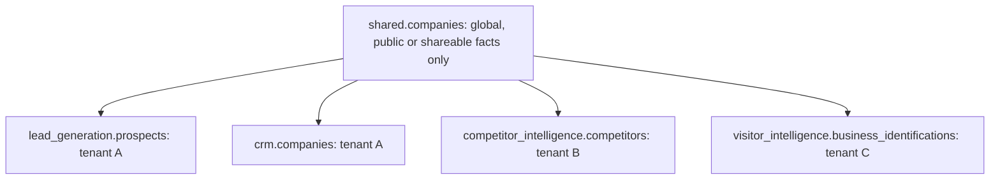

# Database architecture

Status: planning, pending approval. No migrations or SQL files exist. All tables, columns and constraints are in the [data dictionary](data-dictionary.md) and [constraints-and-indexes](constraints-and-indexes.md).

## Summary

One PostgreSQL database with 18 logical schemas and 205 planned tables. Each schema has one owning module or service, and only that owner's repositories can touch it.

| Schema | Owner | Tables | Contents |
|---|---|---|---|
| `platform` | Catalog, subscription, billing, entitlement, usage | 23 | Products, plans, purchases, subscriptions, invoices, entitlements, credits |
| `identity` | Identity, tenancy, membership, platform admin | 19 | Tenants, users, memberships, roles, sessions, MFA, platform admins |
| `shared` | Company and contact identity, reference data | 12 | Canonical companies, tenant contacts, taxonomies, FX |
| `lead_generation` | Module 1 | 14 | Searches, prospects, scores, lists |
| `competitor_intelligence` | Module 2 | 12 | Competitors, observations, opportunities |
| `outreach` | Module 3 | 17 | Campaigns, messages, suppressions |
| `it_assessment` | Module 4 | 11 | Authorizations, checks, findings |
| `crm` | Module 5 | 18 | Companies, deals, activities |
| `proposals` | Module 6 | 12 | Catalog, versions, signatures |
| `visitor_intelligence` | Module 7 | 9 | Sites, sessions, events |
| `chatbot` | Module 8 | 11 | Bots, knowledge, conversations, bookings |
| `customer_expansion` | Module 9 | 9 | Contracts, coverage, recommendations |
| `sales_intelligence` | Module 10 | 11 | Facts, metrics, forecasts |
| `integration` | Integration Management, AI Gateway | 10 | Providers, connections, webhooks, AI records |
| `audit` | Audit | 3 | Audit and security events |
| `notification` | Notification | 4 | Notifications, deliveries |
| `jobs` | Jobs and events | 6 | Jobs, schedules, outbox, deliveries |
| `files` | File storage | 4 | Objects, references, policies |

**Two placements the brief did not specify.** Tenants live in `identity` because memberships depend on them. AI Gateway records live in `integration` and the outbox in `jobs`, rather than adding schemas beyond the brief's 18.

## Ownership rules

1. A repository reads and writes only its own schema, enforced by a static check on SQL.
2. A hard FK crosses schemas only to `identity.tenants`, `shared.companies` or `shared.contacts`. The generator that produced these documents validated this against all 368 planned FKs.
3. All 128 logical refs are validated by services. Orphan checks run periodically and report, but don't delete.
4. A transaction belongs to one owner, plus outbox and audit writes.

## Keys

UUIDv7, application-generated, because:
- Time-ordered keys have better index locality than random UUIDv4.
- IDs can be generated before insert, which helps idempotent commands.

The exposed creation-time information is acceptable for these resources. **Documented exceptions:** `shared.countries` (ISO code), `platform.settings` (key), and link tables with composite keys.

## Preventing cross-tenant references

Each tenant-owned table has `UNIQUE (tenant_id, id)`. A child's FK is `(tenant_id, parent_id) → parent(tenant_id, id)`. This means the database itself refuses a row in tenant A that refers to a parent in tenant B. Logical refs can't use this, so services validate them under RLS: a lookup of another tenant's ID returns nothing, which is treated as not found.

RLS is described in [multi-tenancy](../architecture/multi-tenancy.md).

## Canonical company model

The same company can be a prospect for tenant A and a competitor for tenant B, and neither can detect the other.

**What keeps private data out of `shared`:**
- Writes accept only source-attributed data with licence class `public` or `licensed_shareable`, as a database check confirms.
- Tenant-licensed values go to `lead_generation.prospect_attributes`.
- Tenant-entered names and notes stay on the tenant's relationship tables. `crm.companies.name` is tenant-owned, and may differ from the canonical name.
- `shared.companies` has no `created_by_tenant`, because that would reveal interest.

**Merges.** `shared.company_merges` records the change and `shared.company.merged` tells modules to repoint. Uniqueness conflicts, such as a tenant having both companies as prospects, are resolved by the module, keeping both histories.

**Contacts** differ deliberately. `shared.contacts` is tenant-owned, as ADR-009 explains. Modules still have relationship tables (`crm.contacts`, `lead_generation.prospect_contacts`) over that one tenant-level identity.

## Partitioning

Monthly range partitions apply to `visitor_intelligence.sessions` and `events`, `audit.events` and `security_events`, and `jobs.outbox_events`. Partitions make retention a fast drop rather than a costly delete, and limit index size. The trade-off is that primary keys must include the time column, and nothing can have an FK into these tables, so references to them are logical.

Tenant-specific retention for visitor data is below a partition's granularity, so a sweep job handles sites with shorter retention, while partition drops apply the maximum (730 days).

## Extensions

| Extension | Purpose | Status |
|---|---|---|
| `citext` | Case-insensitive email and domain | Proposed |
| `pgvector` | Chatbot retrieval | D-08; stays inside the one database |
| `pg_trgm` | Fuzzy company and CRM search | D-17 |
| `pgcrypto` | Not required: hashing and encryption are done in the application | Not used |

PostgreSQL 15 or later is required for `NULLS NOT DISTINCT` and column-level `SET NULL`. A newer version should be chosen at Phase 1, based on the support window at the time.

## Deletion strategy

| Pattern | Used for |
|---|---|
| Soft delete (`deleted_at`) | User-managed records, with a restore window |
| Status only | Commercial and legal records that must not disappear: invoices, authorizations |
| Append-only | Ledgers, audit, observations, approvals |
| Cascade | Dependent children of an owned parent |
| Hard expire | Time-limited operational data |
| Partition drop | High-volume data |
| Erasure | Personal data: PII nulled, record kept if a legal or financial reason exists |

The deletion and retention of each table are in the [data dictionary](data-dictionary.md). All retention periods are proposals pending D-14.

## Audit requirements

The data dictionary's "Audited" field gives each table's rule. Audit rows are in `audit.events`, in the same transaction as the change. Generally: configuration, commercial, security and approval changes are always audited. Machine-produced high-volume rows, such as visitor events and delivery events, aren't audited row by row.

## Connections

| Pool | Role | Used by | Bound |
|---|---|---|---|
| Interactive | `msp_app` | `api` | Largest; short statement timeout |
| Worker, per pool | `msp_app` | `worker` | Fixed per pool |
| Analytics | `msp_app` | `analytics` pool | Small; longer statement timeout |
| Ingest | `msp_ingest` | Batch writer | Small; insert only |
| Platform | `msp_platform` | Admin use cases | Small |
| System | `msp_system` | Schedulers, dispatch | Small |
| Migrations | `msp_owner` | `migrate` only | Single |

The bounds keep analytics or ingest from exhausting connections that CRM needs.
