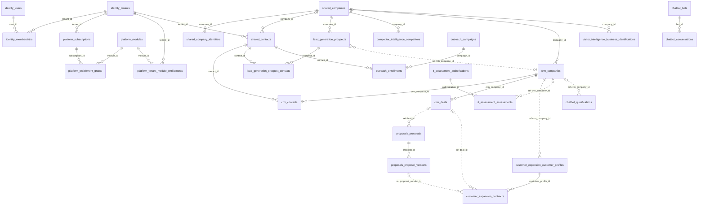

# ERD overview

Status: planning, pending approval. Mermaid ER diagrams, written for GitHub-style rendering. They were checked structurally by the generator but not rendered, because the Mermaid CLI is not installed and installing packages is out of scope for this exercise.

## ERD coverage

| # | ERD | Location |
|---|---|---|
| 1 | Overall platform | Below |
| 2 | Identity and tenant | [identity-erd](identity-erd.md) |
| 3 | Product, bundle, subscription, entitlement | [commercial-erd](commercial-erd.md) |
| 4 | Shared company and contact identity | [shared-identity-erd](shared-identity-erd.md) |
| 5–14 | The ten modules | [module-er-ds](module-er-ds.md) |
| 15 | Integrations, jobs, files, audit, notifications | [module-er-ds](module-er-ds.md) |

## ERD 1: Overall platform

Only the anchor tables are shown. Solid relationships are real foreign keys. Relationship labels beginning `ref` are logical references between modules, with no database foreign key.

## Diagram conventions

- In the detailed ERDs, entity names use `schema__table`, because a dot is not valid in an unquoted Mermaid entity name.
- Types with precision are shown without it (`numeric`, `char`) because of Mermaid syntax limits. The data dictionary has exact types.
- `tenant_id` foreign keys to `identity.tenants` are omitted as lines, since they would dominate every diagram.
- Attribute comments such as `"logical ref crm.companies"` mark references outside the module.

## Tenant ownership at a glance

| Scope | Schemas |
|---|---|
| All tables tenant-owned | `lead_generation`, `competitor_intelligence`, `it_assessment`, `crm`, `proposals`, `visitor_intelligence`, `chatbot`, `customer_expansion`, `sales_intelligence` |
| Mostly tenant-owned | `outreach` (one global table: `global_suppressions`, D-09) |
| Mixed | `identity`, `platform`, `shared`, `integration`, `audit`, `notification`, `jobs`, `files` |
