# Identity and tenant ERD

Status: **planning, pending approval.** Generated from the same specification as the [data dictionary](data-dictionary.md), which remains the fuller reference. Tenant foreign keys are omitted from the relationship lines to keep diagrams readable: assume every table with `tenant_id` belongs to `identity.tenants`. Attribute comments mark foreign keys and logical refs that point outside the diagram.

The MSP user domain and the platform admin domain use separate tables and have no foreign keys between them.

```mermaid
erDiagram
    identity__users ||--o{ identity__user_credentials : "user_id"
    identity__users ||--o{ identity__memberships : "user_id"
    identity__roles ||--o{ identity__memberships : "role_id"
    identity__roles ||--o{ identity__role_permissions : "role_id"
    identity__permissions ||--o{ identity__role_permissions : "permission_id"
    identity__roles ||--o{ identity__invitations : "role_id"
    identity__users ||--o{ identity__sessions : "user_id"
    identity__tenants |o--o{ identity__sessions : "active_tenant_id"
    identity__users ||--o{ identity__verification_tokens : "user_id"
    identity__users ||--o{ identity__mfa_factors : "user_id"
    identity__users ||--o{ identity__mfa_recovery_codes : "user_id"
    identity__platform_admins ||--o{ identity__platform_admin_role_assignments : "admin_id"
    identity__platform_admins |o--o{ identity__platform_admin_role_assignments : "granted_by"
    identity__platform_admins ||--o{ identity__platform_admin_mfa_factors : "admin_id"
    identity__platform_admins ||--o{ identity__platform_admin_sessions : "admin_id"
    identity__tenants {
        uuid id PK
        timestamptz created_at
        timestamptz updated_at
        citext slug
        text name
        text status
        text default_locale
        text default_timezone
        char reporting_currency
        text data_region
        uuid owner_user_id "logical ref identity.users"
        timestamptz suspended_at
        timestamptz deleted_at
    }
    identity__tenant_profiles {
        uuid id PK
        uuid tenant_id FK
        timestamptz created_at
        timestamptz updated_at
        text legal_name
        citext website_domain
        char country_code "logical ref shared.countries"
        jsonb address
        text employee_band
        uuid logo_file_id "logical ref files.objects"
        text onboarding_status
    }
    identity__tenant_icps {
        uuid id PK
        uuid tenant_id FK
        timestamptz created_at
        timestamptz updated_at
        text name
        boolean is_default
        text_array industries
        text_array countries
        int min_employees
        int max_employees
        text_array technologies
        int version
        uuid created_by "logical ref identity.users"
        timestamptz deleted_at
    }
    identity__users {
        uuid id PK
        timestamptz created_at
        timestamptz updated_at
        citext email
        timestamptz email_verified_at
        text display_name
        text locale
        text timezone
        text status
        timestamptz last_login_at
        timestamptz deleted_at
    }
    identity__user_credentials {
        uuid user_id PK,FK
        text password_hash
        timestamptz password_changed_at
        boolean must_change
        timestamptz updated_at
    }
    identity__memberships {
        uuid id PK
        uuid tenant_id FK
        timestamptz created_at
        timestamptz updated_at
        uuid user_id FK
        uuid role_id FK
        text status
        uuid invited_by "logical ref identity.users"
        timestamptz joined_at
        timestamptz removed_at
    }
    identity__roles {
        uuid id PK
        uuid tenant_id FK
        text key
        text name
        boolean is_system
        timestamptz created_at
        timestamptz updated_at
    }
    identity__permissions {
        uuid id PK
        timestamptz created_at
        timestamptz updated_at
        text key
        text description
        boolean deprecated
    }
    identity__role_permissions {
        uuid role_id PK,FK
        uuid permission_id PK,FK
    }
    identity__invitations {
        uuid id PK
        uuid tenant_id FK
        timestamptz created_at
        timestamptz updated_at
        citext email
        uuid role_id FK
        bytea token_hash
        uuid invited_by "logical ref identity.users"
        timestamptz expires_at
        timestamptz accepted_at
        timestamptz revoked_at
    }
    identity__sessions {
        uuid id PK
        timestamptz created_at
        timestamptz updated_at
        uuid user_id FK
        uuid active_tenant_id FK
        bytea token_hash
        bytea ip_hash
        text user_agent
        timestamptz mfa_verified_at
        timestamptz expires_at
        timestamptz idle_expires_at
        timestamptz revoked_at
        text revoke_reason
    }
    identity__verification_tokens {
        uuid id PK
        timestamptz created_at
        timestamptz updated_at
        uuid user_id FK
        text purpose
        bytea token_hash
        timestamptz expires_at
        timestamptz consumed_at
    }
    identity__mfa_factors {
        uuid id PK
        timestamptz created_at
        timestamptz updated_at
        uuid user_id FK
        text kind
        bytea secret_ciphertext
        text key_id
        bytea credential_id
        bytea public_key
        timestamptz verified_at
        timestamptz last_used_at
    }
    identity__mfa_recovery_codes {
        uuid id PK
        timestamptz created_at
        timestamptz updated_at
        uuid user_id FK
        bytea code_hash
        timestamptz used_at
    }
    identity__login_attempts {
        uuid id PK
        bytea email_hash
        bytea ip_hash
        text domain
        boolean succeeded
        text failure_reason
        timestamptz created_at
    }
    identity__platform_admins {
        uuid id PK
        timestamptz created_at
        timestamptz updated_at
        citext email
        text display_name
        text password_hash
        text status
        timestamptz last_login_at
    }
    identity__platform_admin_role_assignments {
        uuid admin_id PK,FK
        text role PK
        uuid granted_by FK
        timestamptz granted_at
    }
    identity__platform_admin_mfa_factors {
        uuid id PK
        timestamptz created_at
        timestamptz updated_at
        uuid admin_id FK
        text kind
        bytea secret_ciphertext
        text key_id
        bytea credential_id
        bytea public_key
        timestamptz verified_at
    }
    identity__platform_admin_sessions {
        uuid id PK
        timestamptz created_at
        timestamptz updated_at
        uuid admin_id FK
        bytea token_hash
        bytea ip_hash
        text user_agent
        timestamptz mfa_verified_at
        timestamptz expires_at
        timestamptz revoked_at
    }
```

