# Module ERDs

Status: **planning, pending approval.** Generated from the same specification as the [data dictionary](data-dictionary.md), which remains the fuller reference. Tenant foreign keys are omitted from the relationship lines to keep diagrams readable: assume every table with `tenant_id` belongs to `identity.tenants`. Attribute comments mark foreign keys and logical refs that point outside the diagram.

ERD numbering follows the brief. ERDs 1 to 4 are in [erd-overview](erd-overview.md), [identity-erd](identity-erd.md), [commercial-erd](commercial-erd.md) and [shared-identity-erd](shared-identity-erd.md).

## ERD 5. Lead Generation

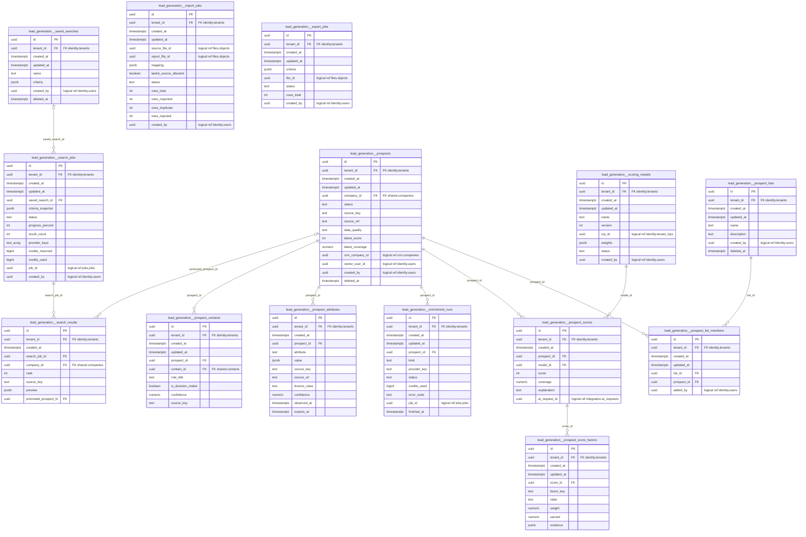

## ERD 6. Competitor Intelligence

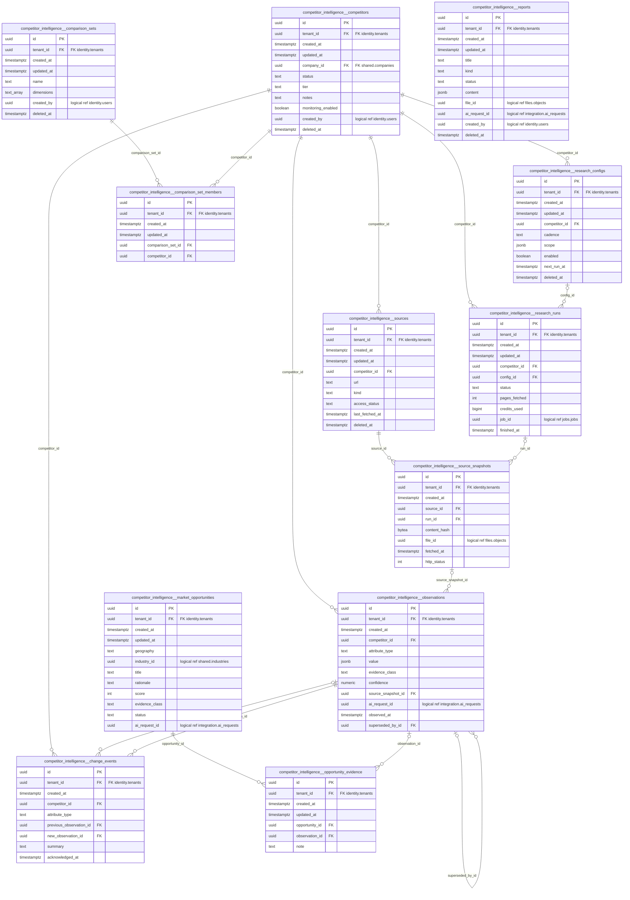

## ERD 7. Outreach

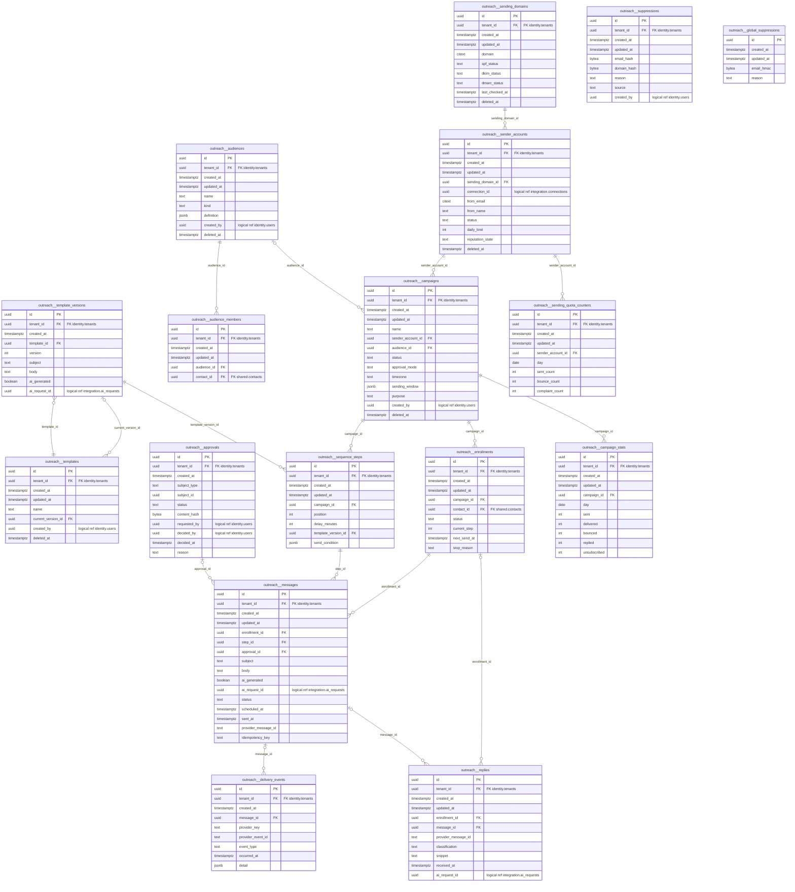

## ERD 8. IT Assessment

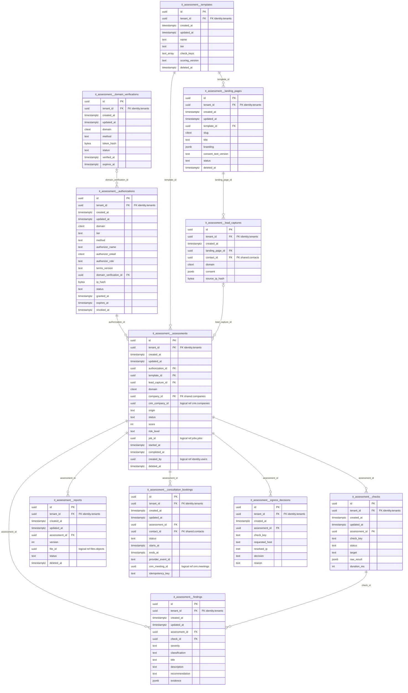

## ERD 9. CRM

```mermaid
erDiagram
    crm__companies |o--o{ crm__contacts : "crm_company_id"
    crm__companies ||--o{ crm__prospect_conversions : "crm_company_id"
    crm__deals |o--o{ crm__prospect_conversions : "deal_id"
    crm__pipelines ||--o{ crm__pipeline_stages : "pipeline_id"
    crm__pipelines ||--o{ crm__deals : "pipeline_id"
    crm__pipeline_stages ||--o{ crm__deals : "stage_id"
    crm__companies ||--o{ crm__deals : "crm_company_id"
    crm__contacts |o--o{ crm__deals : "primary_contact_id"
    crm__deals ||--o{ crm__deal_stage_history : "deal_id"
    crm__pipeline_stages |o--o{ crm__deal_stage_history : "from_stage_id"
    crm__pipeline_stages ||--o{ crm__deal_stage_history : "to_stage_id"
    crm__companies |o--o{ crm__tasks : "crm_company_id"
    crm__deals |o--o{ crm__tasks : "deal_id"
    crm__tasks |o--o{ crm__reminders : "task_id"
    crm__companies |o--o{ crm__meetings : "crm_company_id"
    crm__deals |o--o{ crm__meetings : "deal_id"
    crm__meetings ||--o{ crm__meeting_attendees : "meeting_id"
    crm__contacts |o--o{ crm__meeting_attendees : "contact_id"
    crm__companies |o--o{ crm__activities : "crm_company_id"
    crm__contacts |o--o{ crm__activities : "contact_id"
    crm__deals |o--o{ crm__activities : "deal_id"
    crm__custom_field_definitions ||--o{ crm__custom_field_values : "definition_id"
    crm__deals |o--o{ crm__ai_recommendations : "deal_id"
    crm__companies |o--o{ crm__ai_recommendations : "crm_company_id"
    crm__companies {
        uuid id PK
        uuid tenant_id FK "FK identity.tenants"
        timestamptz created_at
        timestamptz updated_at
        uuid company_id FK "FK shared.companies"
        text name
        citext domain
        text lifecycle
        uuid owner_user_id "logical ref identity.users"
        text source_module
        uuid source_ref
        uuid created_by "logical ref identity.users"
        timestamptz deleted_at
    }
    crm__contacts {
        uuid id PK
        uuid tenant_id FK "FK identity.tenants"
        timestamptz created_at
        timestamptz updated_at
        uuid contact_id FK "FK shared.contacts"
        uuid crm_company_id FK
        boolean is_primary
        uuid owner_user_id "logical ref identity.users"
        timestamptz deleted_at
    }
    crm__prospect_conversions {
        uuid id PK
        uuid tenant_id FK "FK identity.tenants"
        timestamptz created_at
        uuid prospect_id "logical ref lead_generation.prospects"
        uuid crm_company_id FK
        uuid deal_id FK
        uuid converted_by "logical ref identity.users"
    }
    crm__pipelines {
        uuid id PK
        uuid tenant_id FK "FK identity.tenants"
        timestamptz created_at
        timestamptz updated_at
        text name
        boolean is_default
        text status
    }
    crm__pipeline_stages {
        uuid id PK
        uuid tenant_id FK "FK identity.tenants"
        timestamptz created_at
        timestamptz updated_at
        uuid pipeline_id FK
        text key
        text name
        int position
        text kind
        int default_probability
    }
    crm__deals {
        uuid id PK
        uuid tenant_id FK "FK identity.tenants"
        timestamptz created_at
        timestamptz updated_at
        uuid pipeline_id FK
        uuid stage_id FK
        uuid crm_company_id FK
        uuid primary_contact_id FK
        text title
        uuid owner_user_id "logical ref identity.users"
        char currency
        bigint contract_value_minor
        bigint expected_mrr_minor
        int probability
        date expected_close_date
        text status
        timestamptz closed_at
        text loss_reason
        text source_module
        uuid source_ref
        int row_version
        uuid created_by "logical ref identity.users"
        timestamptz deleted_at
    }
    crm__deal_stage_history {
        uuid id PK
        uuid tenant_id FK "FK identity.tenants"
        timestamptz created_at
        uuid deal_id FK
        uuid from_stage_id FK
        uuid to_stage_id FK
        uuid changed_by "logical ref identity.users"
        text reason
    }
    crm__sales_reps {
        uuid id PK
        uuid tenant_id FK "FK identity.tenants"
        timestamptz created_at
        timestamptz updated_at
        uuid user_id "logical ref identity.users"
        bigint quota_minor
        char quota_currency
        text territory
        boolean active
    }
    crm__tasks {
        uuid id PK
        uuid tenant_id FK "FK identity.tenants"
        timestamptz created_at
        timestamptz updated_at
        text title
        text description
        uuid assignee_user_id "logical ref identity.users"
        uuid crm_company_id FK
        uuid deal_id FK
        timestamptz due_at
        text status
        timestamptz completed_at
        uuid created_by "logical ref identity.users"
        timestamptz deleted_at
    }
    crm__reminders {
        uuid id PK
        uuid tenant_id FK "FK identity.tenants"
        timestamptz created_at
        timestamptz updated_at
        uuid task_id FK
        uuid user_id "logical ref identity.users"
        timestamptz remind_at
        timestamptz fired_at
    }
    crm__notes {
        uuid id PK
        uuid tenant_id FK "FK identity.tenants"
        timestamptz created_at
        timestamptz updated_at
        text subject_type
        uuid subject_id
        text body
        uuid created_by "logical ref identity.users"
        timestamptz deleted_at
    }
    crm__attachments {
        uuid id PK
        uuid tenant_id FK "FK identity.tenants"
        timestamptz created_at
        timestamptz updated_at
        text subject_type
        uuid subject_id
        uuid file_id "logical ref files.objects"
        uuid created_by "logical ref identity.users"
        timestamptz deleted_at
    }
    crm__meetings {
        uuid id PK
        uuid tenant_id FK "FK identity.tenants"
        timestamptz created_at
        timestamptz updated_at
        uuid crm_company_id FK
        uuid deal_id FK
        text title
        timestamptz starts_at
        timestamptz ends_at
        text status
        uuid organizer_user_id "logical ref identity.users"
        text provider_event_id
        text source_module
        uuid source_ref
        text outcome
        text idempotency_key
        timestamptz deleted_at
    }
    crm__meeting_attendees {
        uuid id PK
        uuid tenant_id FK "FK identity.tenants"
        timestamptz created_at
        timestamptz updated_at
        uuid meeting_id FK
        uuid contact_id FK
        uuid user_id "logical ref identity.users"
        text response
    }
    crm__activities {
        uuid id PK
        uuid tenant_id FK "FK identity.tenants"
        timestamptz created_at
        text activity_type
        uuid crm_company_id FK
        uuid contact_id FK
        uuid deal_id FK
        uuid actor_user_id "logical ref identity.users"
        text summary
        jsonb detail
        timestamptz occurred_at
        text source_module
        uuid source_event_id
    }
    crm__custom_field_definitions {
        uuid id PK
        uuid tenant_id FK "FK identity.tenants"
        timestamptz created_at
        timestamptz updated_at
        text entity
        text key
        text label
        text field_type
        jsonb options
        boolean archived
    }
    crm__custom_field_values {
        uuid id PK
        uuid tenant_id FK "FK identity.tenants"
        timestamptz created_at
        timestamptz updated_at
        uuid definition_id FK
        uuid subject_id
        jsonb value
    }
    crm__ai_recommendations {
        uuid id PK
        uuid tenant_id FK "FK identity.tenants"
        timestamptz created_at
        timestamptz updated_at
        uuid deal_id FK
        uuid crm_company_id FK
        text kind
        jsonb content
        text status
        uuid ai_request_id "logical ref integration.ai_requests"
        uuid decided_by "logical ref identity.users"
    }
```

## ERD 10. Proposals

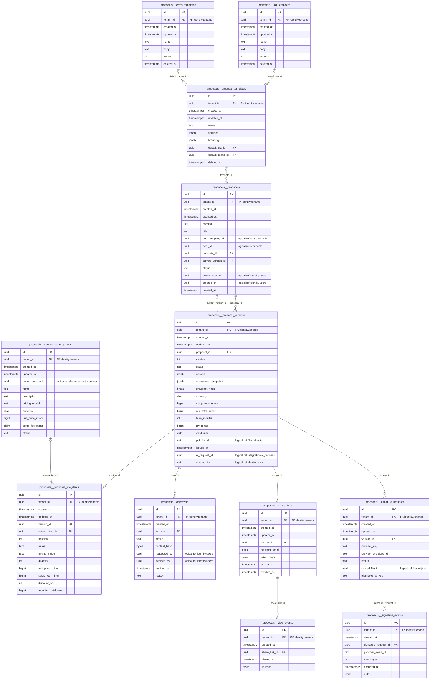

## ERD 11. Visitor Intelligence

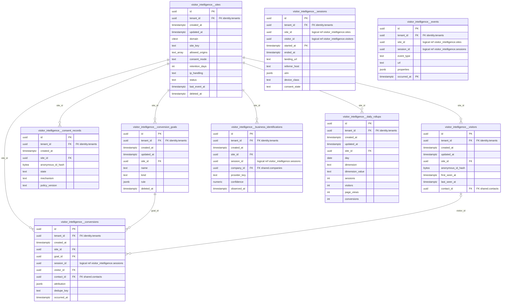

## ERD 12. Chatbot

```mermaid
erDiagram
    chatbot__bots ||--o{ chatbot__knowledge_sources : "bot_id"
    chatbot__bots ||--o{ chatbot__knowledge_chunks : "bot_id"
    chatbot__knowledge_sources ||--o{ chatbot__knowledge_chunks : "source_id"
    chatbot__bots ||--o{ chatbot__qualification_rules : "bot_id"
    chatbot__bots ||--o{ chatbot__booking_configs : "bot_id"
    chatbot__bots ||--o{ chatbot__conversations : "bot_id"
    chatbot__conversations ||--o{ chatbot__messages : "conversation_id"
    chatbot__conversations ||--o{ chatbot__qualifications : "conversation_id"
    chatbot__conversations ||--o{ chatbot__handoffs : "conversation_id"
    chatbot__conversations ||--o{ chatbot__bookings : "conversation_id"
    chatbot__booking_configs ||--o{ chatbot__bookings : "config_id"
    chatbot__bots ||--o{ chatbot__daily_stats : "bot_id"
    chatbot__bots {
        uuid id PK
        uuid tenant_id FK "FK identity.tenants"
        timestamptz created_at
        timestamptz updated_at
        text name
        text public_key
        text_array allowed_origins
        jsonb persona
        text disclosure_text
        text status
        timestamptz deleted_at
    }
    chatbot__knowledge_sources {
        uuid id PK
        uuid tenant_id FK "FK identity.tenants"
        timestamptz created_at
        timestamptz updated_at
        uuid bot_id FK
        text kind
        text title
        uuid file_id "logical ref files.objects"
        text url
        bytea content_hash
        text status
        int version
        timestamptz deleted_at
    }
    chatbot__knowledge_chunks {
        uuid id PK
        uuid tenant_id FK "FK identity.tenants"
        timestamptz created_at
        timestamptz updated_at
        uuid bot_id FK
        uuid source_id FK
        int position
        text content
        vector embedding
        int token_count
    }
    chatbot__qualification_rules {
        uuid id PK
        uuid tenant_id FK "FK identity.tenants"
        timestamptz created_at
        timestamptz updated_at
        uuid bot_id FK
        int position
        text field_key
        text question
        int weight
        boolean required
        timestamptz deleted_at
    }
    chatbot__booking_configs {
        uuid id PK
        uuid tenant_id FK "FK identity.tenants"
        timestamptz created_at
        timestamptz updated_at
        uuid bot_id FK
        uuid connection_id "logical ref integration.connections"
        int duration_minutes
        int buffer_minutes
        int minimum_notice_minutes
        jsonb availability
        timestamptz deleted_at
    }
    chatbot__conversations {
        uuid id PK
        uuid tenant_id FK "FK identity.tenants"
        timestamptz created_at
        timestamptz updated_at
        uuid bot_id FK
        bytea session_token_hash
        uuid visitor_ref "logical ref visitor_intelligence.visitors"
        uuid contact_id FK "FK shared.contacts"
        text status
        timestamptz last_message_at
    }
    chatbot__messages {
        uuid id PK
        uuid tenant_id FK "FK identity.tenants"
        timestamptz created_at
        uuid conversation_id FK
        text role
        text content
        uuid_array retrieved_chunk_ids
        text_array safety_flags
        uuid ai_request_id "logical ref integration.ai_requests"
        uuid sender_user_id "logical ref identity.users"
    }
    chatbot__qualifications {
        uuid id PK
        uuid tenant_id FK "FK identity.tenants"
        timestamptz created_at
        timestamptz updated_at
        uuid conversation_id FK
        jsonb answers
        int score
        text status
        uuid crm_company_id "logical ref crm.companies"
    }
    chatbot__handoffs {
        uuid id PK
        uuid tenant_id FK "FK identity.tenants"
        timestamptz created_at
        timestamptz updated_at
        uuid conversation_id FK
        text reason
        text status
        uuid assigned_user_id "logical ref identity.users"
        timestamptz resolved_at
    }
    chatbot__bookings {
        uuid id PK
        uuid tenant_id FK "FK identity.tenants"
        timestamptz created_at
        timestamptz updated_at
        uuid conversation_id FK
        uuid config_id FK
        uuid contact_id FK "FK shared.contacts"
        timestamptz starts_at
        timestamptz ends_at
        text status
        text provider_event_id
        uuid crm_meeting_id "logical ref crm.meetings"
        text idempotency_key
    }
    chatbot__daily_stats {
        uuid id PK
        uuid tenant_id FK "FK identity.tenants"
        timestamptz created_at
        timestamptz updated_at
        uuid bot_id FK
        date day
        int conversations
        int qualified
        int handoffs
        int bookings
    }
```

## ERD 13. Customer Expansion

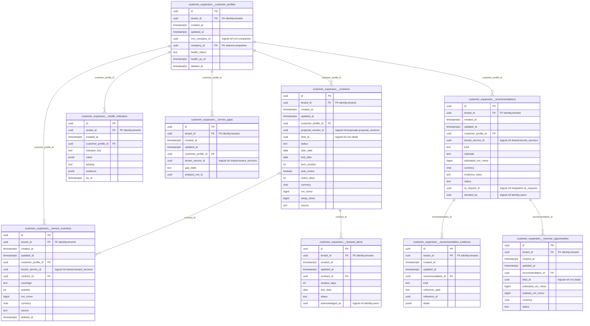

## ERD 14. Sales Intelligence

```mermaid
erDiagram
    sales_intelligence__forecast_runs ||--o{ sales_intelligence__forecast_points : "run_id"
    sales_intelligence__report_definitions |o--o{ sales_intelligence__report_exports : "definition_id"
    sales_intelligence__fact_lead_events {
        uuid id PK
        uuid tenant_id FK "FK identity.tenants"
        timestamptz created_at
        uuid source_event_id
        text event_type
        uuid prospect_ref
        text source_key
        int score
        timestamptz occurred_at
    }
    sales_intelligence__fact_outreach_events {
        uuid id PK
        uuid tenant_id FK "FK identity.tenants"
        timestamptz created_at
        uuid source_event_id
        text event_type
        uuid campaign_ref
        timestamptz occurred_at
    }
    sales_intelligence__fact_deal_events {
        uuid id PK
        uuid tenant_id FK "FK identity.tenants"
        timestamptz created_at
        uuid source_event_id
        text event_type
        uuid deal_ref
        uuid proposal_ref
        uuid owner_user_ref
        text stage_key
        text source_module
        bigint amount_minor
        char currency
        timestamptz occurred_at
    }
    sales_intelligence__fact_revenue_events {
        uuid id PK
        uuid tenant_id FK "FK identity.tenants"
        timestamptz created_at
        uuid source_event_id
        text movement
        uuid contract_ref
        bigint mrr_delta_minor
        char currency
        bigint reporting_mrr_delta_minor
        numeric fx_rate
        timestamptz occurred_at
    }
    sales_intelligence__cost_entries {
        uuid id PK
        uuid tenant_id FK "FK identity.tenants"
        timestamptz created_at
        timestamptz updated_at
        date period_start
        date period_end
        text category
        uuid campaign_ref
        bigint amount_minor
        char currency
        uuid created_by "logical ref identity.users"
        timestamptz deleted_at
    }
    sales_intelligence__metric_snapshots {
        uuid id PK
        uuid tenant_id FK "FK identity.tenants"
        timestamptz created_at
        timestamptz updated_at
        text metric_key
        text period_grain
        date period_start
        text dimension
        text dimension_value
        numeric value
        text value_kind
        timestamptz computed_at
    }
    sales_intelligence__forecast_runs {
        uuid id PK
        uuid tenant_id FK "FK identity.tenants"
        timestamptz created_at
        timestamptz updated_at
        text kind
        text method_version
        jsonb assumptions
        text status
        date as_of
        uuid job_id "logical ref jobs.jobs"
    }
    sales_intelligence__forecast_points {
        uuid id PK
        uuid tenant_id FK "FK identity.tenants"
        timestamptz created_at
        timestamptz updated_at
        uuid run_id FK
        date period_start
        bigint expected_minor
        bigint low_minor
        bigint high_minor
        char currency
    }
    sales_intelligence__report_definitions {
        uuid id PK
        uuid tenant_id FK "FK identity.tenants"
        timestamptz created_at
        timestamptz updated_at
        text name
        jsonb definition
        uuid created_by "logical ref identity.users"
        timestamptz deleted_at
    }
    sales_intelligence__report_exports {
        uuid id PK
        uuid tenant_id FK "FK identity.tenants"
        timestamptz created_at
        timestamptz updated_at
        uuid definition_id FK
        uuid file_id "logical ref files.objects"
        text status
        uuid created_by "logical ref identity.users"
    }
    sales_intelligence__ai_insights {
        uuid id PK
        uuid tenant_id FK "FK identity.tenants"
        timestamptz created_at
        timestamptz updated_at
        text scope
        jsonb content
        uuid_array cited_metric_ids
        uuid ai_request_id "logical ref integration.ai_requests"
    }
```

## ERD 15. Shared integrations, jobs, files, audit and notifications

### `integration`

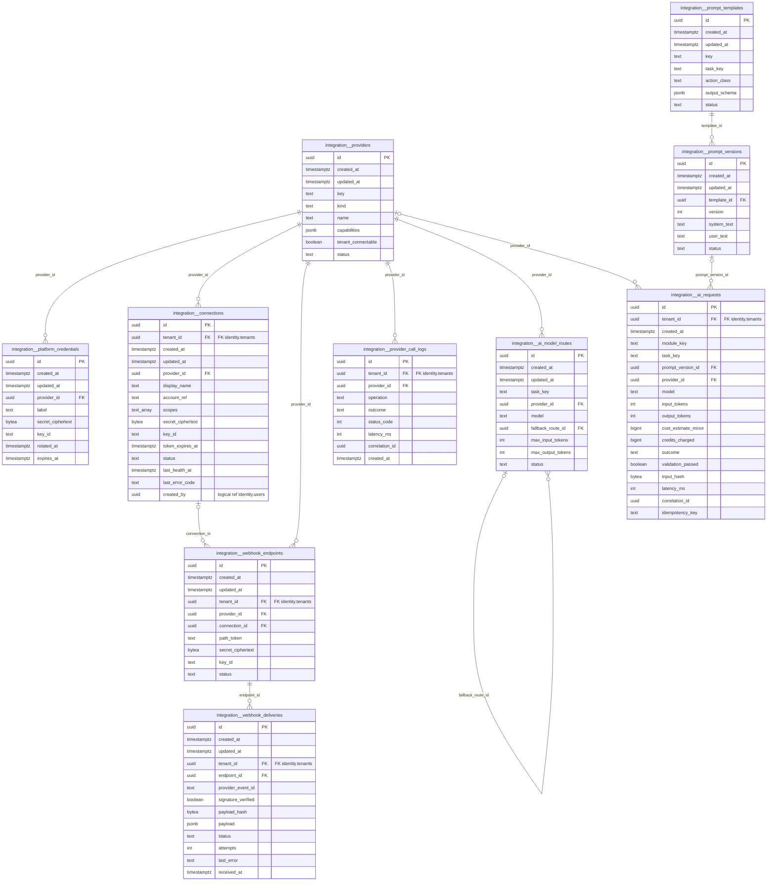

### `jobs`

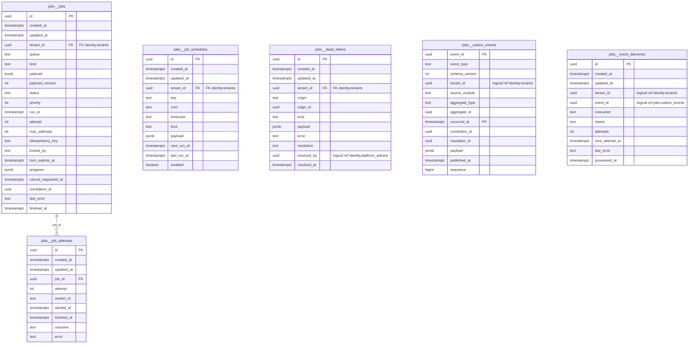

### `files`

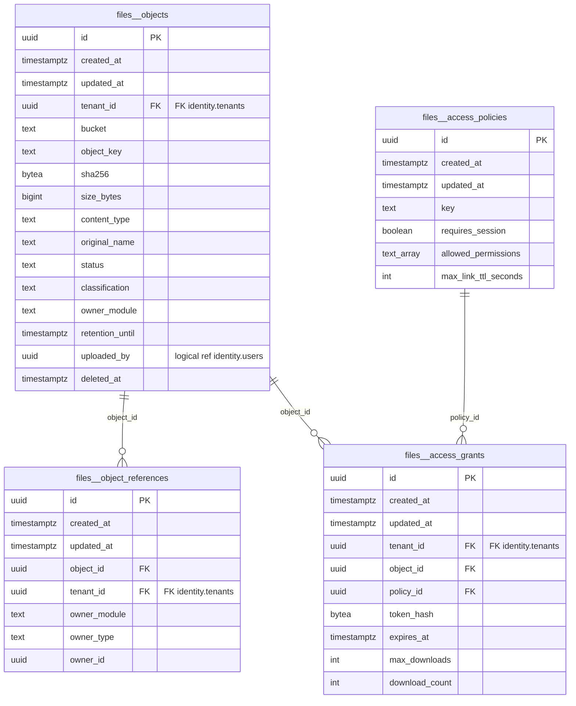

### `audit`

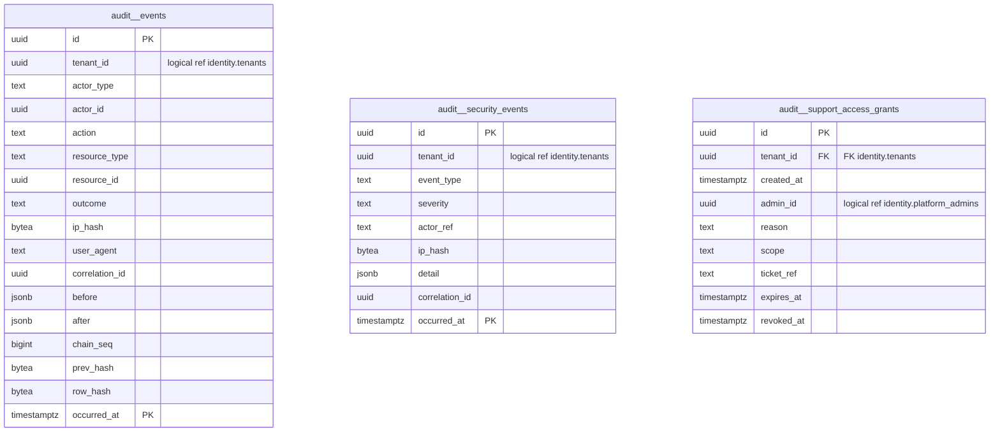

### `notification`

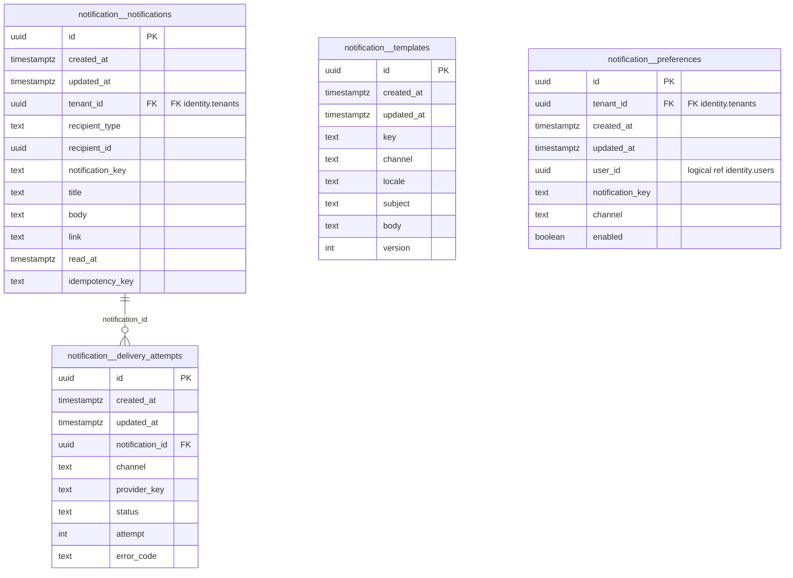
