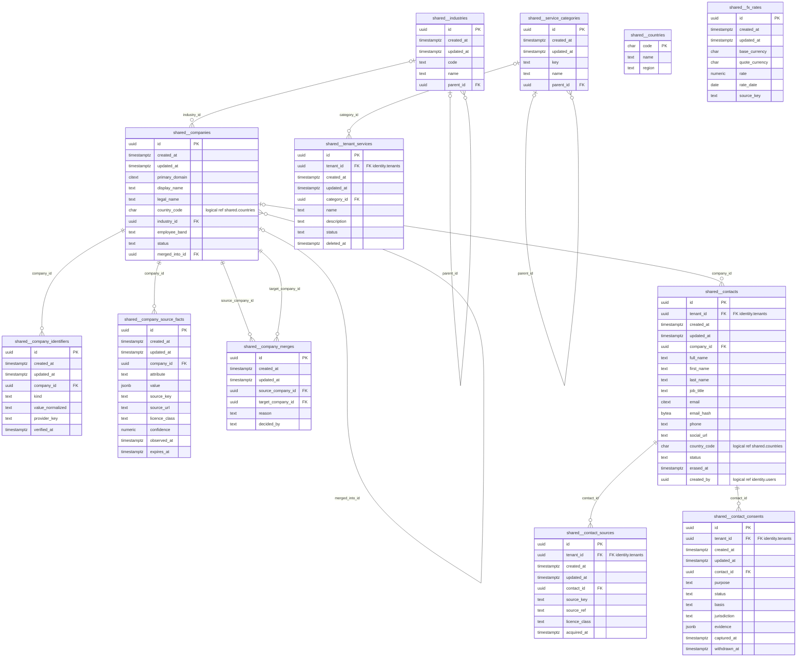

# Shared company and contact identity ERD

Status: **planning, pending approval.** Generated from the same specification as the [data dictionary](data-dictionary.md), which remains the fuller reference. Tenant foreign keys are omitted from the relationship lines to keep diagrams readable: assume every table with `tenant_id` belongs to `identity.tenants`. Attribute comments mark foreign keys and logical refs that point outside the diagram.

- `shared.companies` is global and holds only public or shareable-licensed facts.
- A company becomes a prospect, CRM company or competitor through a separate tenant-owned table in that module's schema. One company can be a prospect for one MSP and a competitor for another without either MSP seeing it.
- `shared.contacts` is tenant-scoped by design (ADR-009, D-06), so there is no global person record.

