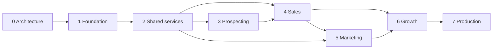

# Implementation roadmap

Status: planning, pending approval. **Implementation isn't authorized.** Complexity is relative (S, M, L, XL, XXL), with no dates, since team size is unknown and estimates would be falsely precise.

**Every phase's gate requires explicit product-owner approval.** All phases also inherit the [security release requirements](../security/security-architecture.md) and the [testing strategy](testing-strategy.md).

## Adjustments to the brief's phase content

Order is unchanged. Three small additions, needed to make the order work:

1. **Phase 1 gains a minimal transactional mail adapter.** Email verification and password reset can't wait for Notifications in Phase 2.
2. **Phase 1 audit writes are synchronous**, not event-based, as the outbox arrives in Phase 2.
3. **Phase 3 "convert to CRM" ships as a contract with a test fake.** The real CRM arrives in Phase 4, so the end-to-end flow completes there.

Until Phase 7's purchase workflow exists, admins grant entitlements directly, allowing testing of everything else.

**Environment and legal plan (2026-11-06).** The system runs locally, then on a testing server, and is then handed to the product owner's boss, who is responsible for legal review. Legal review named in a phase gate is therefore carried out at or before handover, not during that phase. Modules are built to the approved defaults, and real sending, scanning and tracking stay disabled until that review is complete. Phase 7's production deployment and launch steps also happen after handover.

## Phase 0: Architecture and requirements

- **Objectives:** a reviewed blueprint and resolved key decisions.
- **Dependencies:** none.
- **Deliverables:** this documentation set.
- **Tasks:** review documents; decide items in [open-decisions](open-decisions.md); optionally render ERDs for visual review.
- **Risks:** decisions deferred into build, and legal input arriving late.
- **Acceptance:** D-02, D-06, D-15, D-21, D-22 and D-23 (development part) answered. Recommendations approved on 2026-11-06.
- **Testing:** document consistency only.
- **Complexity:** M.
- **Gate:** explicit approval to start Phase 1. Implementation stays blocked until then.

## Phase 1: Platform foundation

- **Objectives:** a secure, tenant-aware skeleton with both apps.
- **Dependencies:** Phase 0.
- **Deliverables:** monorepo; Go backend with roles; `identity` and `platform` schemas; client shell and admin app; migrations pipeline; CI with lint, boundary checks and isolation tests; local Docker environment.
- **Tasks:** repository setup; kernel packages (database with tenant context, HTTP, authz, logging); authentication; tenants and memberships; platform admins and RBAC; module catalog; products and bundles; subscription records; entitlements and admin grant; audit; minimal mail adapter; design tokens and UI patterns; module manifests with placeholder screens; OpenAPI pipeline.
- **Risks:** RLS and pooling errors are costly to fix later; the boundary tooling may feel excessive, but must be in from the start.
- **Acceptance:** register, verify, create workspace, invite, switch; admin signs in with MFA, activates a module, and the client updates; suspended module blocked at the API; admin and user sessions not interchangeable; isolation suite running and failing on a planted fault.
- **Testing:** auth, authorization matrix, tenant isolation, migrations, E2E sign-up.
- **Complexity:** XL.
- **Gate:** penetration-style review of auth and tenancy, then approval.

## Phase 2: Shared services

- **Objectives:** common services that modules depend on.
- **Dependencies:** Phase 1; D-05 (at least one AI provider), D-06, D-07, D-16, D-17.
- **Deliverables:** Company and Contact Identity, AI Gateway, integration framework with adapters and webhook inbox, job system, outbox and dispatcher, file storage with scanning, PDF rendering, notifications, usage and credits, Egress Guard, analytics plumbing.
- **Tasks:** one service at a time, each with fake providers for tests; admin screens for providers, jobs, usage and AI routes; privacy tooling skeleton.
- **Risks:** building for imagined needs. Build only what Phases 3 to 6 use, and keep adapters minimal. Outbox and job correctness are hard to retrofit.
- **Acceptance:** crash and retry tests pass; webhook forgery is rejected; SSRF test suite passes; credits can't overspend under load; a sample module can call AI with quotas and logging.
- **Testing:** job, event, idempotency, SSRF, adapter contract, AI safety.
- **Complexity:** XXL.
- **Gate:** reliability and SSRF review, then approval.

## Phase 3: Prospecting and intelligence

- **Objectives:** Lead Generation and Competitor Intelligence.
- **Dependencies:** Phase 2; a company-data provider (D-05), which is the main external dependency.
- **Deliverables:** both modules' backend and all screens.
- **Tasks:** search jobs; enrichment; deterministic scoring; lists; CSV; competitor sources; research fetch; observations; change detection; opportunities; reports.
- **Risks:** provider data quality and licence limits may affect features; research fetching has legal limits.
- **Acceptance:** module acceptance criteria in [lead-generation](../modules/lead-generation.md) and [competitor-intelligence](../modules/competitor-intelligence.md); a company as prospect for A and competitor for B shows no leak.
- **Testing:** scoring, licence routing, SSRF, label enforcement, isolation.
- **Complexity:** XL.
- **Gate:** review of data licensing and evidence labelling, then approval.

## Phase 4: Sales and conversion

- **Objectives:** CRM, IT Assessment and Proposals.
- **Dependencies:** Phase 2; Phase 3 for lead conversion; D-11, D-12; e-sign provider.
- **Deliverables:** three modules; CRM registry contract; forward-only stage rule; contract recording in Customer Expansion (its data model and consumer only, D-03).
- **Tasks:** CRM first, since others depend on it; then Proposals, then Assessment, whose isolated worker pool and lab tests need the most care.
- **Risks:** CRM scope growth; assessment legal questions; commercial calculation errors.
- **Acceptance:** module criteria; Workflow A works through to a won deal, using a stub for outreach; issued proposals are immutable at the database level.
- **Testing:** CRM state, commercial formula tables, assessment network lab, signature webhooks.
- **Complexity:** XXL.
- **Gate:** legal review of assessment text, plus independent check of scanner network controls; approval.

## Phase 5: Marketing and engagement

- **Objectives:** Outreach, Visitor Intelligence and Chatbot.
- **Dependencies:** Phases 2 and 4; D-08, D-09, D-10; legal input; email and calendar providers.
- **Deliverables:** three modules, tracker and widget, ingest role.
- **Tasks:** Outreach gates first, with sending disabled until tested; ingest pipeline with load test; Chatbot with prompt injection suite.
- **Risks:** the highest legal and reputational risk in the project: deliverability, tracking law, prompt injection.
- **Acceptance:** module criteria; approval bypass tests fail to send; consent browser tests pass; adversarial chat suite passes on leakage; ingest load leaves CRM within target.
- **Testing:** send gates, unsubscribe race, consent, ingest load, adversarial AI, booking races.
- **Complexity:** XXL.
- **Gate:** legal review of Outreach and tracking; limited real-send pilot only with explicit approval, because it contacts external people.

## Phase 6: Customer growth and analytics

- **Objectives:** Customer Expansion and Sales Intelligence.
- **Dependencies:** Phases 4 and 5.
- **Deliverables:** both modules, forecasts, reports, RLS performance comparison.
- **Tasks:** expansion analysis; recommendations; metric definitions; rollups; forecasts; dashboards.
- **Risks:** metric definitions disputed late, so define with stakeholders first; forecast credibility on sparse data.
- **Acceptance:** module criteria; full E2E scenario passes, with Tenant B isolation; MRR reconciles with contracts.
- **Testing:** metric fixtures, replay, late-activation, full E2E.
- **Complexity:** L.
- **Gate:** review of metric definitions, then approval.

## Phase 7: Commercial and production readiness

- **Objectives:** ability to sell and run safely in production.
- **Dependencies:** all phases; D-01, D-04, D-13, D-14, D-18, D-19, D-23.
- **Deliverables:** purchase flow; admin review queue; billing integration; enforced limits; production infrastructure; monitoring; backups; runbooks; legal documents in place.
- **Tasks:** payment integration; reconciliation; dunning; independent penetration test; load tests against the stated profile; restore drill; incident runbooks; production deployment.
- **Risks:** tax and payment complexity; test findings requiring rework; underestimated operations effort.
- **Acceptance:** [acceptance criteria](acceptance-criteria.md) release list complete; no open critical or high findings; restore drill within targets; load targets met or formally revised.
- **Testing:** load, security, restore, payment scenarios.
- **Complexity:** XL.
- **Gate:** launch approval, by the product owner, with sign-off from legal.

## Sequencing notes

- **Earliest usable product** would be Phases 1, 2, and CRM from Phase 4. If an earlier commercial release matters, this can be discussed, but it changes the requested order.
- **Parallel work** is possible once contracts exist: inside Phase 3 and Phase 5, modules can run in parallel. Phase 2's job and outbox come before others.
- **Stop-and-review points** are the gates. Each later implementation prompt should restate security requirements, as the brief asks.
