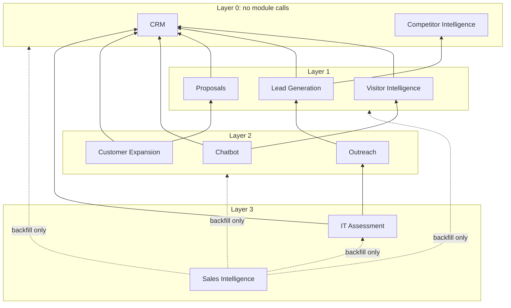

# Cross-module contracts

Status: planning, pending approval. This file is the complete list of allowed module-to-module interactions. CI's import linter is generated from the first table: anything not listed fails the build.

## Allowed synchronous calls

Each call uses the callee's `contract` package, and returns a typed "not available" result when the callee's data cannot be used. Calls run outside the caller's transaction.

| Caller | Callee contract | Operations | Entitlement of callee required? | If unavailable |
|---|---|---|---|---|
| Lead Generation | CRM `Registry`, `Deals` | `EnsureCompany`, `EnsureContact`, `CreateDeal` | Registry no; Deals yes | Convert stays as registry-only, with a prompt to buy CRM |
| Lead Generation | Competitor Intelligence | `IsCompetitor` | Yes | Skip warning |
| Outreach | Lead Generation | `ListMembersOfList` | Yes | Audience import unavailable |
| IT Assessment | CRM `Registry`, `Meetings` | `EnsureCompany`, `RecordMeeting` | Registry no; Meetings yes | Keep captured data locally |
| IT Assessment | Outreach | `IsSuppressed` | No (data plane) | Fail closed for marketing mail |
| Proposals | CRM `Registry`, `Deals` | `GetCompanySummary`, `EnsureCompany`, `GetDealSummary` | Registry no; Deals yes | Name from the proposal snapshot |
| Chatbot | CRM `Registry`, `Meetings` | `EnsureCompany`, `EnsureContact`, `RecordMeeting` | Registry no; Meetings yes | Retained in Chatbot; job retries |
| Chatbot | Visitor Intelligence | `GetVisitorContext` | Yes, plus visitor consent | No context used |
| Visitor Intelligence | CRM `Registry` | `EnsureCompany` | No | User sees the registry result |
| Customer Expansion | CRM `Registry`, `Deals` | `EnsureCompany`, `GetCompanySummary`, `SetLifecycle`, `CreateDeal` | Registry no; Deals yes | Opportunity stays open |
| Customer Expansion | Proposals | `GetIssuedSummary` | No (data plane) | Use deal values and flag |
| Sales Intelligence | Any module's lifecycle export | `Backfill` only | No | Report gap |

## Dependency layers

The table above forms an acyclic graph, as the brief requires. A module may call only modules in lower layers.

**CRM calls no other module.** Information flowing back to CRM arrives as events, which aren't dependencies in this sense because the publisher doesn't know its consumers. Where a CRM screen shows detail from another module, such as an assessment summary or contract panel, the client application fetches it from that module's API, so the panel is hidden if the module isn't entitled.

The import linter also fails the build on any cycle, so a new synchronous call that would close a loop has to become an event.

**Calls to shared platform services** (Identity, Entitlements, Company and Contact Identity, AI Gateway and so on) are unrestricted from modules.

## Ownership of important records

| Record | Owner | Others may |
|---|---|---|
| Canonical company | Company Identity | Resolve or read |
| Contact identity | Contact Identity | Resolve, read, record consent |
| Prospect relationship | Lead Generation | Read summary |
| CRM company and contact | CRM | Use registry contract |
| Deal and stage | CRM | Request by contract, react to events |
| Campaign and suppression | Outreach | Check suppression |
| Issued proposal and snapshot | Proposals | Read summary |
| Contract, active MRR | Customer Expansion | Read summary, react to events |
| Meeting | CRM; Chatbot and IT Assessment hold their booking records | Record through contract |
| Metric, forecast | Sales Intelligence | n/a |
| Entitlement | Entitlement service | Check |

## Registry idempotency

`EnsureCompany` resolves in this order:

1. Same `company_id` already exists for tenant: return it.
2. Same source module and source reference: return it.
3. Otherwise create. A unique constraint handles a race, followed by a re-read.

`EnsureContact` works the same way, using `contact_id`.

## Event routes

See the matrix in [event-contracts](../api/event-contracts.md).

## Contract change rules

- Contract packages are versioned with the code, so a compile error catches a breaking change.
- Event schemas are versioned as in [event-architecture](../architecture/event-architecture.md).
- Each contract has a fake for consumers' tests, and each implementation runs a shared conformance test, so the fake and real behaviour can't drift.
- Any new row in the table above requires an architecture review.

## Prohibited

- Reading or writing another module's tables, even with read-only SQL.
- Sharing a database transaction across modules.
- Passing repositories or database handles across a contract.
- Using a job or event to carry another tenant's IDs.
- Returning private fields, such as CRM notes or scores, through summaries used by public-facing features.
