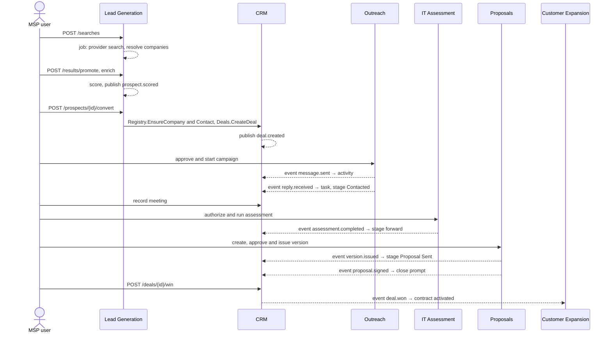
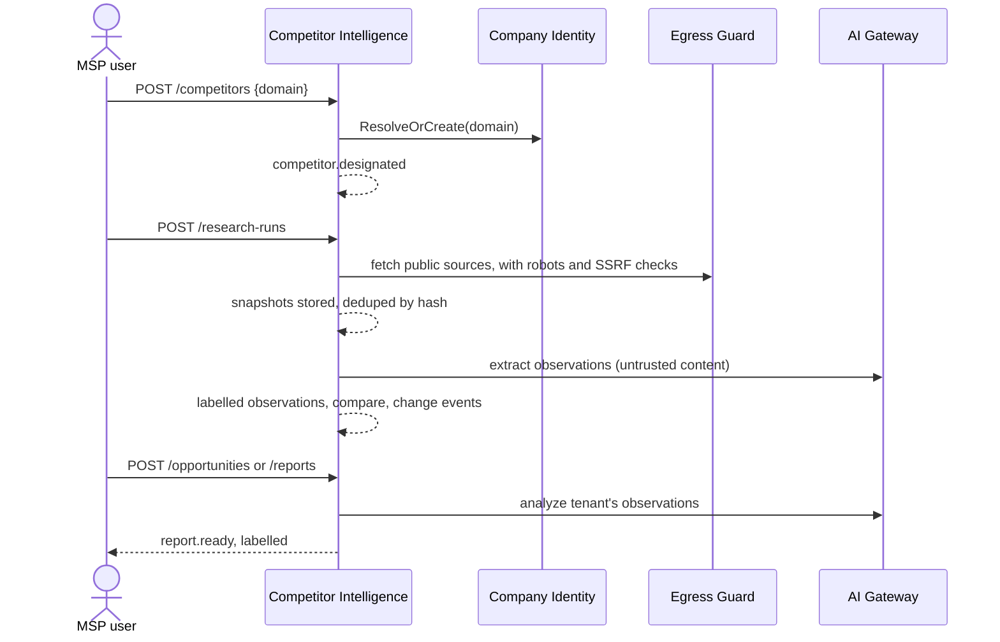
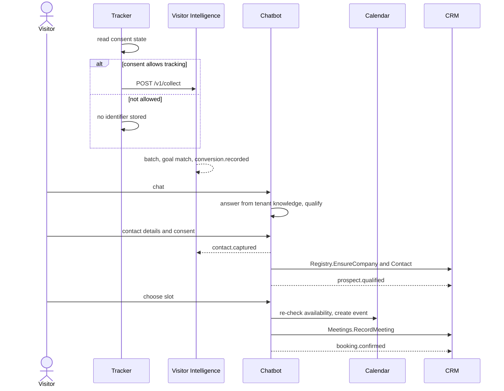
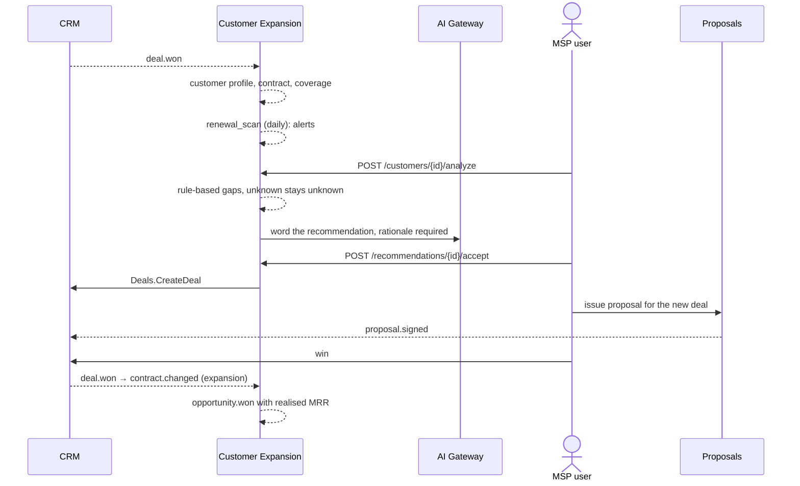
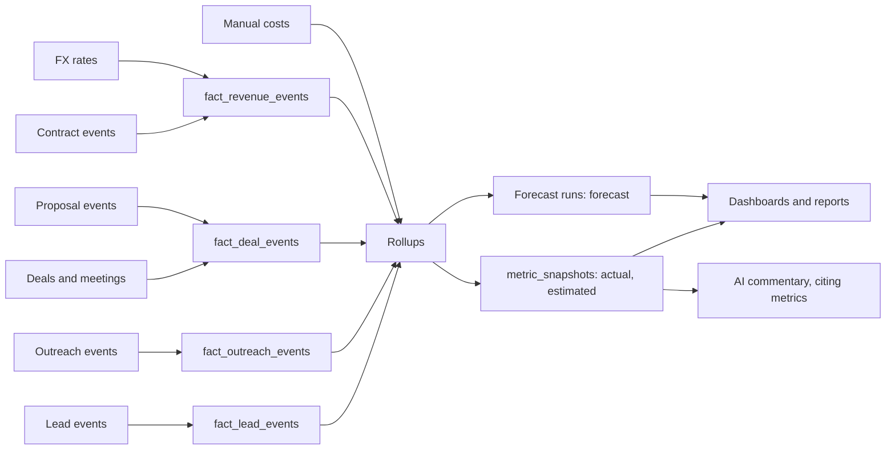

# End-to-end workflows

Status: planning, pending approval. All workflows carry one `correlation_id`, from start to finish. "Tx" names the module that owns a local transaction: no transaction spans modules.

## Workflow A: Prospect to customer

**Modules:** Lead Generation, CRM, Outreach, IT Assessment, Proposals, Customer Expansion, Sales Intelligence.

| Step | Call | Event | Tx owner | Failure and retry | Idempotency | Audit |
|---|---|---|---|---|---|---|
| Discover | `POST /searches` | `search.completed` | Lead Generation | Job backoff; partial result | Idempotency key | Criteria |
| Enrich | `POST /enrich` | `prospect.enriched` | Lead Generation | Retry; `no_data` isn't a failure; credits released | Prospect, kind, day | Yes |
| Score | Job | `prospect.scored` | Lead Generation | Retry | Input hash | Model publish |
| Qualify and convert | `POST /convert`, then CRM contract | `prospect.converted`, `crm.deal.created` | CRM, then Lead Generation | CRM failure leaves the prospect unchanged, and retry is safe | Unique prospect conversion | Yes |
| Outreach | Campaign APIs | `message.sent`, etc. | Outreach | See send gates | Enrollment and step | Approvals |
| Reply | Webhook or polling | `reply.received`, `sequence.stopped` | Outreach | Stop first, then classify | Provider message ID | Yes |
| Meeting | `POST /meetings` | `meeting.scheduled` | CRM | Calendar failure shows a local meeting with a warning | Idempotency key | Yes |
| Assessment | Authorization then run | `assessment.completed` | IT Assessment | Check-level; inconclusive allowed | Assessment ID | Full evidence |
| Proposal | Approve, issue | `version.issued`, `proposal.signed` | Proposals | Freeze first; PDF and send are retried | Version; provider event | Yes |
| Win | `POST /win` | `crm.deal.won` | CRM | Conflict gives 409 | Idempotent if already won | Yes |
| Contract | Consumer | `contract.activated` | Customer Expansion | Delivery retried; dead letter alert | Unique tenant and deal | Yes |

**Consistency.** Eventual between modules. CRM's forward-only stage rule protects against out-of-order events. If a late event arrives after a win, it adds a timeline entry but doesn't change the stage.

## Workflow B: Competitor research

**Modules:** Company Identity, Competitor Intelligence.

| Concern | Design |
|---|---|
| Data ownership | Canonical company in `shared`. All else tenant-private |
| Transactions | Per step, in Competitor Intelligence |
| Failure | Disallowed source recorded and skipped; run becomes `partial`; AI failure leaves snapshots to retry |
| Retry | Fetch backoff per domain; no retry on robots disallow |
| Idempotency | Run ID, content hash, unchanged content creates no observation |
| Audit | Designation, sources, reports |

## Workflow C: Website conversion

**Modules:** Visitor Intelligence, Chatbot, Contact Identity, CRM.

| Concern | Design |
|---|---|
| Consent | Checked by the tracker and the ingest role; a chat works without tracking consent, and chat data needs its own notice |
| Linking visitor to contact | Only when the person volunteers details in that session, and tracking consent exists |
| Transactions | Local per module; booking commits after the calendar confirms |
| Failure | Ingest drops without affecting the site; AI outage leads to contact form; calendar failure means no confirmation; CRM failure leads to retried sync |
| Idempotency | Dedupe keys for conversions; booking key; registry resolve |
| Audit | Bookings and human takeover; no audit for raw events |

## Workflow D: Customer expansion

**Modules:** CRM, Customer Expansion, Proposals, Sales Intelligence.

| Concern | Design |
|---|---|
| Data ownership | Identity and deal in CRM; coverage and contracts in Customer Expansion |
| Failure | AI down: rule-based result. CRM down on accept: retry, opportunity remains open |
| Idempotency | One opportunity per recommendation; unique tenant and deal |
| Audit | Accept, dismiss, contract MRR change with before and after |

An expansion deal must be distinguished from a new-logo deal: `crm.deals.source_module` set to `customer_expansion` marks it, and the resulting contract event classifies as `expansion`.

## Workflow E: Revenue analytics

**Modules:** All producers, Sales Intelligence.

| Concern | Design |
|---|---|
| Transactions | Consumer inserts one fact per event, in its own transaction |
| Ordering | Deal stage facts carry `occurred_at`; current state calculated at rollup |
| Failure | Consumer retries; lag shows as "as of"; dead-letter alert |
| Retry | Standard backoff |
| Idempotency | Unique source event per fact table |
| Audit | Cost entries, exports |
| Late data | Rollups recompute a rolling window (proposed: 7 days); closed historic months stay correctable by a rerun that records the rerun |
