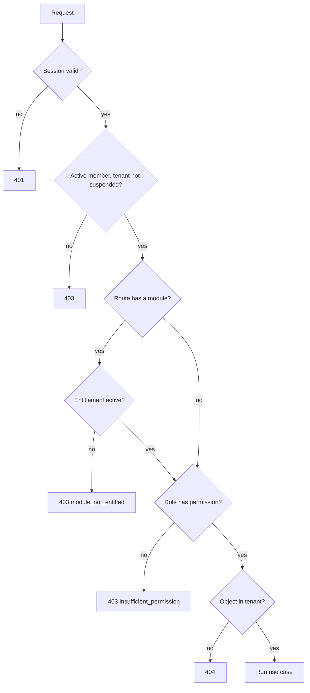

# Authentication and authorization

Status: planning, pending approval.

## Two separate access domains

| | MSP workspace users | Platform administrators |
|---|---|---|
| Tables | `identity.users`, `memberships` | `identity.platform_admins` |
| Sessions | `identity.sessions` | `identity.platform_admin_sessions` |
| Host | App | Admin |
| Registration | Self-service, invitation | Invitation by Super Admin only |
| MFA | Optional, workspace policy can require | Mandatory |
| Session length (proposed) | 7-day absolute, 24-hour idle | 8-hour absolute, 30-minute idle |
| Roles | Tenant roles | Platform roles |

An MSP user can't become a platform admin by any role change. The same person would hold two unrelated accounts. Support access uses a time-limited grant in `audit.support_access_grants`, and the action is attributed to the admin, not to a tenant user.

## Authentication flows

**Registration.** Email, password, workspace name. An account is created as `pending_verification`, and verification is sent. No tenant data can be accessed until verified. The response doesn't reveal whether an email already exists.

**Password rules.** Minimum length of 12, with a maximum length limit before hashing to prevent abuse. Checked against a list of common or breached passwords (source decided in D-21). No forced composition rules or periodic rotation.

**Login.** Generic errors, consistent timing. Progressive throttling by account and IP. A successful login creates a new session token.

**Password reset.** Single-use, hashed, 30-minute tokens. All sessions are revoked after reset, and the user is notified.

**MFA.** TOTP and WebAuthn, with hashed recovery codes. Enabling or removing a factor needs recent authentication and generates a notification.

**Sessions.** A 256-bit random token, stored hashed. Cookie: `__Host-session`, `HttpOnly`, `Secure`, `SameSite=Lax`, `Path=/`. Users can list and revoke sessions. Removal from a workspace takes effect immediately, because the active tenant membership is checked on each request.

**Brute force.** Limits in Redis, with a database fallback. Repeated failures produce a security event. Lockouts are temporary to avoid enabling a denial-of-service attack on an account.

**Recent authentication** is required for: password or MFA change, billing changes, role changes for admins, data export, API key or provider credential changes, offboarding, and all sensitive platform admin actions.

## Authorization model

Confirmed decision: module access is tenant-wide. There are no per-employee purchases or per-employee module entitlements. Roles control what members can do, and can differ by function, but are not sold.

## Tenant roles and permission matrix

These are suggested defaults, stored as data. **Y** allows, **R** is read-only, **–** denies. *Marketing Manager* and *Sales Representative* differ by business function.

### Workspace

| Permission | Owner | MSP Admin | Sales Mgr | Sales Rep | Marketing Mgr | Analyst | Viewer |
|---|---|---|---|---|---|---|---|
| `team.manage` | Y | Y | – | – | – | – | – |
| `settings.manage` | Y | Y | – | – | – | – | – |
| `integrations.manage` | Y | Y | – | – | – | – | – |
| `billing.manage` | Y | Y* | – | – | – | – | – |
| `billing.read` | Y | Y | – | – | – | – | – |
| `privacy.manage` | Y | Y | – | – | – | – | – |
| `audit.read` | Y | Y | – | – | – | – | – |
| Transfer ownership, start offboarding | Y | – | – | – | – | – | – |

\* Owner can restrict this.

### Modules

| Permission group | Owner | MSP Admin | Sales Mgr | Sales Rep | Marketing Mgr | Analyst | Viewer |
|---|---|---|---|---|---|---|---|
| `lead.read` | Y | Y | Y | Y | Y | Y | Y |
| `lead.search`, `.write`, `.enrich` | Y | Y | Y | Y | Y | – | – |
| `lead.import`, `.export` | Y | Y | Y | – | Y | – | – |
| `lead.configure` | Y | Y | Y | – | Y | – | – |
| `competitor.read` | Y | Y | Y | Y | Y | Y | Y |
| `competitor.write`, `.research` | Y | Y | Y | – | Y | – | – |
| `competitor.configure` | Y | Y | – | – | Y | – | – |
| `outreach.read` | Y | Y | Y | Y | Y | Y | Y |
| `outreach.write` | Y | Y | Y | Y | Y | – | – |
| `outreach.send`, `.approve` | Y | Y | Y | – | Y | – | – |
| `outreach.configure` | Y | Y | – | – | Y | – | – |
| `outreach.suppression_remove` | Y | Y | – | – | – | – | – |
| `assessment.read` | Y | Y | Y | Y | Y | Y | Y |
| `assessment.run` | Y | Y | Y | Y | – | – | – |
| `assessment.configure` | Y | Y | Y | – | Y | – | – |
| `crm.read` | Y | Y | Y | Y | Y | Y | Y |
| `crm.write` | Y | Y | Y | Y | Y | – | – |
| `crm.close_deal` | Y | Y | Y | Y | – | – | – |
| `crm.delete`, `.export` | Y | Y | Y | – | – | – | – |
| `crm.configure` | Y | Y | Y | – | – | – | – |
| `proposal.read` | Y | Y | Y | Y | – | Y | Y |
| `proposal.write`, `.send` | Y | Y | Y | Y | – | – | – |
| `proposal.approve`, `.configure` | Y | Y | Y | – | – | – | – |
| `visitor.read` | Y | Y | Y | Y | Y | Y | Y |
| `visitor.write` | Y | Y | Y | Y | Y | – | – |
| `visitor.configure` | Y | Y | – | – | Y | – | – |
| `chatbot.read` | Y | Y | Y | Y | Y | Y | Y |
| `chatbot.handle` | Y | Y | Y | Y | Y | – | – |
| `chatbot.configure` | Y | Y | – | – | Y | – | – |
| `expansion.read` | Y | Y | Y | Y | – | Y | Y |
| `expansion.write`, `.analyze` | Y | Y | Y | Y | – | – | – |
| `sales_intel.read` | Y | Y | Y | Y | Y | Y | Y |
| `sales_intel.team`, `.forecast` | Y | Y | Y | – | – | Y | – |
| `sales_intel.costs` | Y | Y | Y | – | Y | – | – |
| `sales_intel.export` | Y | Y | Y | – | Y | Y | – |

A default like a Marketing Manager having no `proposal.read` is a suggestion, not a restriction on what the role could become.

### Role strategy

- **Launch:** seeded system roles with the matrix above, not editable by tenants. Permissions are data and role checks use permissions, not role names, so later changes need no code rewrite.
- **Later (D-20):** tenant-defined custom roles, built from the same permissions, in `identity.roles`.
- A role change takes effect on the next request.

## Platform role matrix

| Capability | Super Admin | Support | Billing Admin | Integration Admin | Analyst |
|---|---|---|---|---|---|
| Manage platform admins | Y | – | – | – | – |
| Tenant status (suspend, reactivate) | Y | – | – | – | – |
| View tenant metadata | Y | Y | Y | – | Y |
| Help tenant users (resend, unlock) | Y | Y | – | – | – |
| Catalog, plans, prices, promotions | Y | – | Y | – | – |
| Purchase review, activate, suspend, expire | Y | – | Y | – | – |
| Revoke entitlement | Y | – | – | – | – |
| Payments, refunds | Y | – | Y | – | – |
| Credits and limits | Y | – | Y | – | – |
| Provider and AI configuration | Y | – | – | Y | – |
| Jobs, dead letters | Y | Y | – | – | – |
| Audit search | Y | Limited | Billing only | Integrations only | – |
| Platform analytics | Y | – | Y | – | Y |
| Tenant content (only through a support grant) | Grant-approver | Grant | – | – | – |
| Platform settings | Y | – | – | – | – |

## Sensitive operation protections

| Operation | Protections |
|---|---|
| Change roles or remove Owner | Last-owner rule, recent auth, notify |
| Change billing | `billing.manage`, recent auth |
| Connect a provider | `integrations.manage`, OAuth with signed state |
| Start a campaign or approve | Specific permissions, optional separation of duties |
| Export data | Specific permissions, audit with row counts, short-lived link |
| Offboard | Owner only, recent auth, typed confirmation, waiting period |
| Admin activation or revocation | Role, recent auth, reason, audit, tenant notified |
