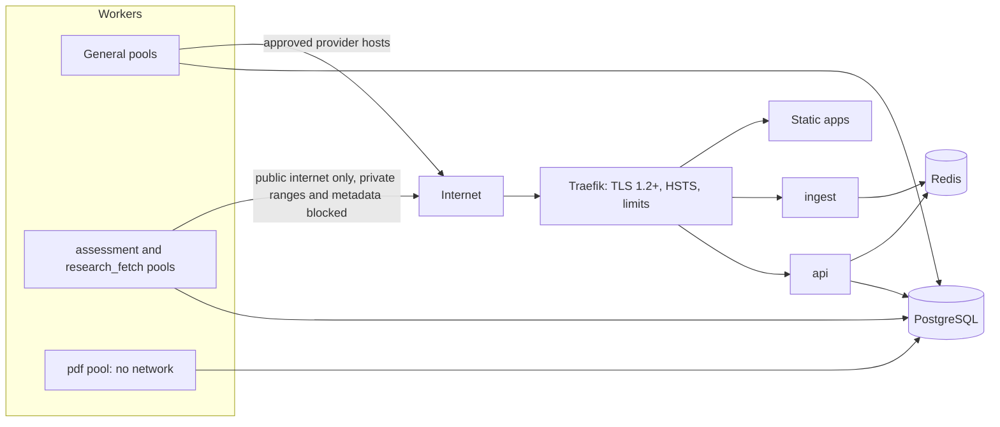

# Security architecture

Status: planning, pending approval. Security is a release requirement: a phase can't pass its approval gate with an open critical or high finding, unless formally accepted by the product owner.

## Principles

Deny by default; authorize on the server; assume input is hostile; least privilege in code, database and network; defence in depth for tenant isolation; no secrets in code, logs, events or AI input; keep evidence for sensitive actions.

## Controls

| Requirement | Design |
|---|---|
| Password hashing | Argon2id, parameters tuned by benchmark and stored in the PHC string; rehash on login when parameters change |
| Authentication and sessions | [authentication-and-authorization](authentication-and-authorization.md) |
| MFA | Optional for MSP users, with an Owner-enforceable workspace policy; mandatory for platform admins |
| Platform RBAC | Five roles; separate domain |
| Tenant authorization | Membership, entitlement, permission, object checks |
| Tenant isolation | [tenant-isolation](tenant-isolation.md) |
| SQL injection | Parameterized SQL only; allowlisted sort fields; static checks |
| Input validation | Schema validation at the API edge, domain rules in services; size limits everywhere |
| Output encoding | Context-aware templating; JSON API; escaped email and PDF templates |
| XSS | React escaping; one sanitizer; strict CSP with no inline scripts, `frame-ancestors` set |
| CSRF | `SameSite=Lax` plus a session-bound token on state-changing requests, and `Origin` check. Public token and webhook endpoints don't use cookies |
| CORS | Allowlist only for the app and admin origins. Public widget routes allow only each bot's or site's configured origins, without credentials |
| SSRF | Egress Guard (ADR-019) on all tenant-influenced fetches; webhook and OAuth URLs are fixed by adapters |
| File uploads | Hosted upload to a private bucket; size, type sniffing, scanning; separate download host; quarantine |
| Webhooks | Signature and timestamp verification; replay dedupe; quick acknowledge |
| Rate limits | By IP, user, tenant, route class and provider; stricter on login, reset, public forms and search |
| Secrets | Managed secret store; never in images or source. The specific product is D-23 |
| Provider credentials | Envelope encryption with `key_id`; rotation supported |
| Audit | Same-transaction audit events, hash chained with a per-tenant sequence, no update or delete rights; `audit.verify_chain` reports altered, missing or unlinked rows |
| Idempotency | Keys on all external effects |
| Safe errors | Problem Details; no internals; `404` for other tenants' objects |
| Dependency scanning | Go and npm vulnerability scans, image scan, licence check and pinned versions in CI; secret scanning |
| Security testing | Static analysis, isolation suite, DAST on staging, independent penetration test before launch |
| Backups | Encrypted, off-site, access-limited |
| Disaster recovery | Timed restore drills, recorded |
| Privacy and retention | [privacy-and-compliance](privacy-and-compliance.md) |

## Network layout

Only Traefik is exposed. Database and Redis are on private networks, require authentication and use TLS where they cross hosts. Admin can be further restricted by IP or VPN.

## Security headers

`Strict-Transport-Security`, `Content-Security-Policy`, `X-Content-Type-Options: nosniff`, `Referrer-Policy: strict-origin-when-cross-origin` (`no-referrer` on token pages), `Permissions-Policy`, and `frame-ancestors 'none'` other than the chat frame, which uses the bot's allowed origins.

## Encryption

| Data | Protection |
|---|---|
| In transit | TLS externally and between hosts |
| At rest | Volume and bucket encryption, plus application-level encryption for credentials and MFA secrets |
| Hashes | Session tokens, share links and verification tokens stored only as hashes |
| Keyed hashes | HMAC for email hash and IP hash; keys rotate where the use allows it |

## Release requirements

Each implementation phase must pass: threat review for new features, tenant isolation tests, authorization tests, dependency scan clean of critical and high, secret scan clean, audit coverage test, and error-safety test. These apply to every later implementation prompt.

## Administrative safeguards

- Super Admin actions alert, and there should be at least two Super Admins, with hardware-backed MFA recommended.
- Support cannot silently read tenant data: access needs a time-limited grant, visible to the tenant (D-22).
- No production database access for routine work. Break-glass access is logged and reviewed.
