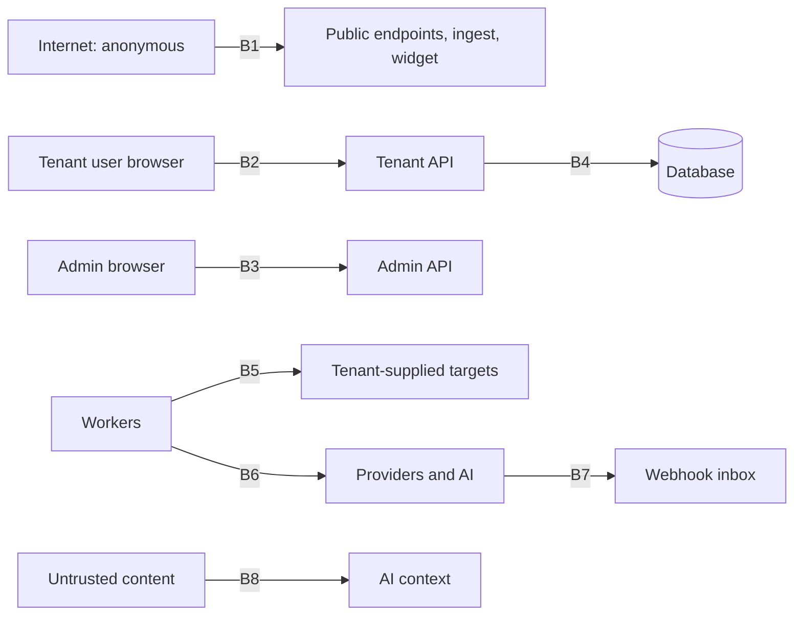

# Threat model

Status: planning, pending approval. Method: STRIDE per trust boundary, then specific abuse cases. To be repeated at each implementation phase as designs become concrete. Likelihood and impact are design-time estimates (L, M, H).

## Assets

Tenant business data; contact personal data; credentials and provider tokens; platform admin access; sender reputation; provider quotas and money; authorization evidence; audit integrity; platform availability.

## Attackers

Malicious or compromised tenant user; a malicious tenant abusing the platform (spam, scanning); anonymous internet user; website visitor or email sender supplying malicious content (prompt injection); compromised platform admin or insider; compromised provider or dependency; a competitor scraping data.

## Trust boundaries

## Threat register

| ID | Threat | STRIDE | L | I | Controls | Residual |
|---|---|---|---|---|---|---|
| T1 | Tenant reads another tenant's data via ID or missing filter | I | M | H | Layers in [multi-tenancy](../architecture/multi-tenancy.md), generated route tests, canary | Low |
| T2 | Tenant ID tampering in request | T, E | M | H | Tenant only from session | Very low |
| T3 | SSRF to cloud metadata or internal services through assessments, research or knowledge URLs | I, E | H | H | Egress Guard, DNS pinning, redirect checks, container egress rules | Low to medium; requires ongoing testing |
| T4 | Platform used to scan third parties without authorization | S, R | H | H | Tiers, verification for active checks, limits, abuse process, opt-out, evidence | Medium: Tier 1 attestation can be false, so its checks are limited to public reads |
| T5 | Spam through Outreach | R, DoS | H | H | Approvals, limits, authentication, reputation pause, suppression, terms, admin review | Medium: requires active abuse monitoring |
| T6 | Prompt injection makes chatbot reveal data | I | H | H | Only public knowledge in reach, tenant-filtered retrieval, schema output | Low for data disclosure |
| T7 | Prompt injection makes chatbot say false or harmful things | T | H | M | Limited scope, disclaimers, disclosure, test suite | Medium: can't be eliminated |
| T8 | Injected content in fetched pages poisons reports | T | M | M | Labelling, human review, source links | Medium |
| T9 | Injected reply text causes an action | E | M | M | Replies can only stop sequences; classification is non-binding | Low |
| T10 | Stored XSS through names, notes, URLs, AI output, visitor data | T, I | M | H | Escaping, sanitizer, CSP, admin separation | Low |
| T11 | Account takeover by credential stuffing | S | H | H | Throttling, breached password checks, MFA, notifications | Medium for users without MFA |
| T12 | Admin account compromise | E | L | H | Mandatory MFA, separate host, short sessions, alerts, optional IP limit | Low to medium |
| T13 | Insider reading tenant data | I | L | H | Grants, audit, least privilege, tenant visibility | Low to medium |
| T14 | Webhook forgery activates a module or marks a payment | S, E | M | H | Signature, timestamp, dedupe, and admin activation as a second control | Low |
| T15 | Entitlement bypass through hidden routes or jobs | E | M | M | Backend gate, OpenAPI parity test, job start checks | Low |
| T16 | Race on credits causes overspending | T | M | M | Atomic reservations, ledger | Low |
| T17 | Proposal or share-link guessing or leakage | I | L | H | 256-bit tokens, hashed, expiry, no-referrer, revocation | Low; forwarded links are inherent |
| T18 | Tampering with an issued proposal | T, R | L | H | Trigger, hash, audit | Very low |
| T19 | Malicious file: malware, polyglot, parser exploit | E | M | H | Scan, sniffing, sandboxed extract and PDF, separate host | Low to medium |
| T20 | PDF renderer SSRF | I | M | H | No network pool, inlined assets | Low |
| T21 | Tracker spam pollutes analytics or fills storage | T, DoS | H | M | Origin checks, rate limits, bot filter, quotas | Medium: site keys are public |
| T22 | Public form abuse: mail bombing a victim using the assessment or chat | DoS | M | M | CAPTCHA, limits, confirmation mail design | Low to medium |
| T23 | Tracker compromise harms customers' sites | T | L | H | Small audited code, SRI option, release signing | Low |
| T24 | Credential or token theft from database | I | L | H | Envelope encryption, external key store, no logging | Low |
| T25 | Dependency compromise | T, E | M | H | Pinned versions, scans, review, egress limits | Medium |
| T26 | Audit tampering | R | L | H | No update grant, hash chain, anchoring | Low |
| T27 | Inference from canonical data | I | M | M | No interest signal, no tenant-origin data | Low |
| T28 | AI cost exhaustion | DoS | H | M | Budget per bot and tenant, rate limits, fallback | Low |
| T29 | Mass extraction of company data through search or exports | I | M | M | Rate limits, credit cost, licence export rules, monitoring | Medium |
| T30 | CSRF on state-changing routes | T | L | M | SameSite, token, Origin check | Low |
| T31 | Outreach or email header injection | T | L | M | Encoded values, strict builder | Low |
| T32 | Noisy neighbour starves others | DoS | H | M | Tenant concurrency limits, pools, rate limits | Low to medium |
| T33 | Backup exposure | I | L | H | Encryption, key separation, access limits | Low |
| T34 | Calendar or mailbox OAuth scope abuse | I | L | H | Least scopes, encrypted tokens, revocation, no AI access to mailbox data beyond the reply | Low |
| T35 | A revoked module keeps acting through queued work | E | M | M | Checks before each side effect; revocation consumers | Low |
| T36 | Booking race or double booking | T | M | L | Hold, re-check, idempotency | Low |
| T37 | Data exposure to AI provider | I | M | H | Minimization, contract terms, no secrets, logging policy | Medium, dependent on provider |
| T38 | Enumeration of users or tenants | I | M | L | Generic responses and timing | Low |

## Abuse scenarios requiring product policy

Technical controls can't fully address these. They need terms, monitoring and admin process:

1. An MSP imports purchased contact lists. Controls: attestation, bounce thresholds, reputation pause, review.
2. An MSP attests falsely to scan a competitor. Controls: Tier 1 is public reads, abuse contact, domain opt-out, tenant suspension.
3. An MSP uses the chatbot for deceptive statements. Controls: terms and report path.
4. An MSP uses a "free assessment" to frighten prospects. Controls: honest report wording, and classifications that are not editable by the tenant.

## Review triggers

Re-run this model when: adding a provider, adding a public endpoint, widening AI capabilities, changing assessment checks, adding API keys, or before any phase's approval gate.
